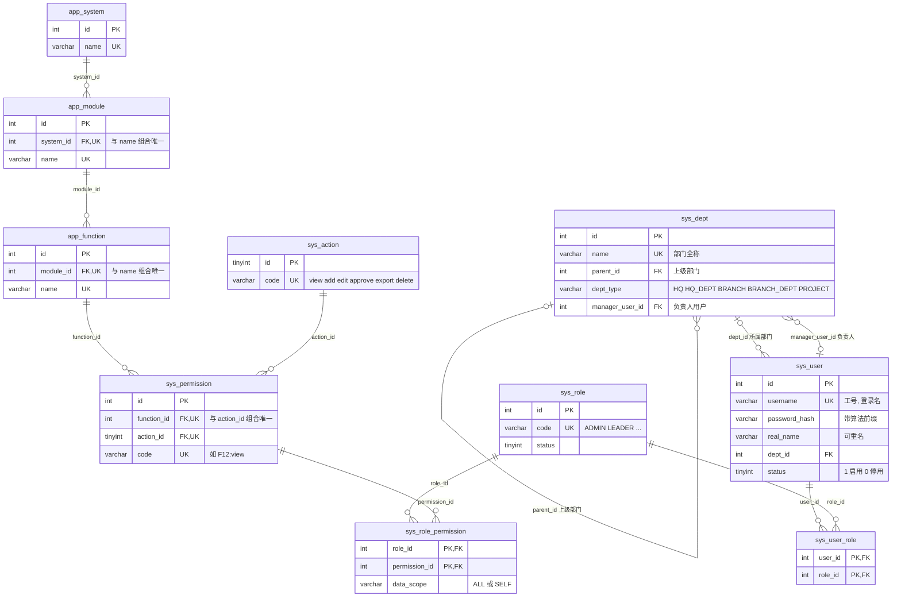

# 数据字典

主责：成员 1。状态：RBAC0 第一版，对应迁移 [V001__create_core_tables.sql](../../database/migrations/V001__create_core_tables.sql)。已在一次性 MySQL 8.4 库上实测建表、导入、约束和回滚。标注“待确认”或“待统一”的地方还没有定论。

- 数据库：MySQL 8.0.16 及以上（CHECK 约束从此版本起生效，部门树查询用递归 CTE），小组候选 8.4 LTS。引擎 InnoDB，字符集 utf8mb4，排序规则 utf8mb4_0900_ai_ci。
- 命名：`sys_` 是用户、组织、角色、权限等系统表，`app_` 是权限清单里的应用资源目录，`v_` 是视图。索引前缀：`uk_` 唯一、`idx_` 普通、`fk_` 外键、`ck_` 检查。
- 主键：整数自增，`sys_action` 用固定编号。导入时写入固定 ID，所以重复导入的结果相同。接口可以把整数 ID 输出成字符串，库结构不受影响。
- 时间：`DATETIME`，按服务器时区，部署时统一为 Asia/Shanghai。
- 删除策略：外键的删除行为写在“键 / 约束”列，每张表后再汇总一次。未注明的是 MySQL 默认的 RESTRICT，即有引用时拒绝删除。
- 来源列：`部门表.X`、`清单.X`、`员工表.X` 分别指《部门信息表》《应用软件功能权限清单》《员工信息表》的列 X（员工表的真实列名待拿到原表后确认）；`派生` 是导入脚本计算的值；`固定` 是脚本内置常量；`系统` 是数据库或应用运行时写入。清洗规则见 [导入质量规则](import-rules.md)。
- 字典里不写真实姓名、电话和密码样例。

## ER 图

核心思路：**权限 = 功能点 × 操作**。清单有 359 个功能点，乘以 6 种操作得到 2154 条权限；清单里一个格子（如“查看/编辑本人”）拆成多条角色授权。视图 `v_user_permission` 汇总每个用户最终拥有的权限，不在图中。

## 概念与表

| 概念 | 表 | 重要关系与约束 | 阶段 |
| --- | --- | --- | --- |
| 用户 | `sys_user` | 用户名唯一；角色通过关联表维护 | RBAC0 |
| 部门 | `sys_dept`，邻接表（`parent_id` 自关联） | 只有一个根节点；禁止上级循环；负责人存用户 ID | RBAC0 |
| 角色 | `sys_role` | 稳定角色码唯一；一个用户可以有多个角色 | RBAC0 |
| 资源与权限 | `app_system` > `app_module` > `app_function`，`sys_action`，`sys_permission` | 程序按 ID 和权限码判断，不按显示名称 | RBAC0 |
| 用户角色 | `sys_user_role` | 组合唯一；RBAC2 起分配时校验约束 | RBAC0 |
| 角色权限 | `sys_role_permission` | 组合唯一；带数据范围 `data_scope` | RBAC0 |
| 有效权限 | 视图 `v_user_permission` | 并集，ALL 优先于 SELF，默认拒绝 | RBAC0 |
| 角色层级 | 计划新增 `sys_role_inherit(senior_role_id, junior_role_id)`，视图改为递归 CTE | senior 继承 junior；无环；单父还是多父待 Q-05 | RBAC1 |
| 约束 | 计划新增约束表 | 区分分配时、激活时、请求时校验；类型与样例待 Q-13 | RBAC2 |
| 会话 | 待定 | 登录用户、已激活角色、失效信息；是否持久化、如何撤销待确认 | 待定 |

## 1. sys_dept 部门

| 字段 | 类型 | 可空 | 默认 | 键 / 约束 | 来源 | 说明 |
| --- | --- | --- | --- | --- | --- | --- |
| id | INT | 否 | 自增 | PK | 派生：源表行序 | 部门 ID |
| name | VARCHAR(64) | 否 | — | UK `uk_dept_name` | 部门表.部门名称 | 全称；分公司下属部门写成“分公司-部门” |
| short_name | VARCHAR(32) | 否 | — | — | 派生 | 全称中第一个“-”之后的部分，没有“-”时等于全称 |
| parent_id | INT | 是 | NULL | FK `fk_dept_parent` → sys_dept.id，有下级时拒绝删除；`idx_dept_parent` | 部门表.上级部门（按名称查 ID） | 根节点为空 |
| dept_type | VARCHAR(16) | 否 | — | CHECK `ck_dept_type` | 派生 | HQ：根节点；HQ_DEPT：二级且名称不以“分公司”结尾；BRANCH：二级且以“分公司”结尾；PROJECT：三级且含“项目经理部”；BRANCH_DEPT：其余三级 |
| level | TINYINT | 否 | — | — | 派生 | 到根节点的层数，1/2/3。可由树推出，冗余存储便于查询 |
| manager_name | VARCHAR(32) | 是 | NULL | — | 部门表.部门经理 | 原始姓名，只用于核对，程序不按它判断 |
| manager_user_id | INT | 是 | NULL | FK `fk_dept_manager` → sys_user.id，用户删除时置空 | 派生：按负责人关联规则 | 负责人以用户 ID 为准；关联不上时为空并写进核对报告 |
| sort_no | INT | 否 | 0 | — | 派生：同 id | 显示顺序 |
| created_at | DATETIME | 否 | CURRENT_TIMESTAMP | — | 系统 | 创建时间 |

删除策略：

- 有下级部门或有用户的部门不能删除，先转移下级部门和人员。
- 负责人用户被删除时，部门保留，`manager_user_id` 置空。
- 上级关系不能成环。外键防不住环，导入脚本会拒绝有环的源表；以后提供“修改上级部门”的接口时，要先用递归 CTE 检查新上级是否在本部门的子树里。

## 2. sys_user 用户

| 字段 | 类型 | 可空 | 默认 | 键 / 约束 | 来源 | 说明 |
| --- | --- | --- | --- | --- | --- | --- |
| id | INT | 否 | 自增 | PK | 派生 | 用户 ID，admin 固定为 1 |
| username | VARCHAR(32) | 否 | — | UK `uk_user_username` | 员工表.工号；没有员工表时生成 E0001 起的编号 | 业务唯一标识和登录名。admin、staff 是保留的演示账号 |
| password_hash | VARCHAR(255) | 否 | — | — | 派生：初始密码的哈希 | 带算法前缀，导入脚本生成 `{pbkdf2@SpringSecurity_v5_8}` 加 96 位十六进制（16 字节盐 + 32 字节哈希）。不存明文，不返回前端。最终算法待与后端统一 |
| real_name | VARCHAR(32) | 否 | — | `idx_user_real_name` | 员工表.姓名 | 允许重名，重名不等于同一账号 |
| dept_id | INT | 是 | NULL | FK `fk_user_dept` → sys_dept.id，被引用的部门不能删除；`idx_user_dept` | 员工表.公司 + 部门，按组织映射规则 | 只有 admin 为空 |
| position | VARCHAR(32) | 是 | NULL | — | 员工表.岗位 | 只展示，不用于授权（Q-11） |
| gender | CHAR(1) | 是 | NULL | CHECK `ck_user_gender` | 员工表.性别 | M / F，由“男/女”转换，无法识别时置空 |
| phone | VARCHAR(20) | 是 | NULL | — | 员工表.电话 | 按文本存，保留前导 0。是否唯一、能否用于登录待统一 |
| email | VARCHAR(64) | 是 | NULL | — | 员工表.邮箱 | — |
| status | TINYINT | 否 | 1 | CHECK `ck_user_status` | 系统 | 1 启用，0 停用；停用用户在视图中没有任何权限 |
| last_login_at | DATETIME | 是 | NULL | — | 系统 | 登录成功时更新 |
| created_at | DATETIME | 否 | CURRENT_TIMESTAMP | — | 系统 | 创建时间 |
| updated_at | DATETIME | 否 | CURRENT_TIMESTAMP，更新时自动刷新 | — | 系统 | 最后修改时间 |

删除策略：删除用户时，其用户-角色记录自动删除，其负责部门的 `manager_user_id` 置空。成员 1 建议日常用 `status = 0` 停用代替物理删除，保留追溯线索（待与成员 4 统一）。

## 3. sys_role 角色

| 字段 | 类型 | 可空 | 默认 | 键 / 约束 | 来源 | 说明 |
| --- | --- | --- | --- | --- | --- | --- |
| id | INT | 否 | 自增 | PK | 固定 1–5 | 角色 ID |
| code | VARCHAR(32) | 否 | — | UK `uk_role_code` | 固定 | ADMIN、LEADER、DEPT_MANAGER、PROJECT_MANAGER、STAFF，对应清单的 5 个角色列。程序按 code 判断，不按名称 |
| name | VARCHAR(32) | 否 | — | — | 清单.角色列名 | 系统管理员、公司领导、部门经理、项目经理、普通员工 |
| description | VARCHAR(255) | 是 | NULL | — | 派生 | 说明来自清单哪一列 |
| sort_no | INT | 否 | 0 | — | 派生：同 id | 显示顺序 |
| status | TINYINT | 否 | 1 | CHECK `ck_role_status` | 系统 | 1 启用，0 停用；停用角色不参与有效权限计算 |
| created_at | DATETIME | 否 | CURRENT_TIMESTAMP | — | 系统 | 创建时间 |

删除策略：删除角色时，其用户-角色和角色-权限记录一并删除。

## 4. app_system 软件系统

| 字段 | 类型 | 可空 | 默认 | 键 / 约束 | 来源 | 说明 |
| --- | --- | --- | --- | --- | --- | --- |
| id | INT | 否 | 自增 | PK | 派生：在清单中首次出现的顺序 | 系统 ID |
| name | VARCHAR(64) | 否 | — | UK `uk_system_name` | 清单.软件系统（合并单元格向下填充） | 18 个，最后一个“系统管理后台”是本平台自己 |
| sort_no | INT | 否 | 0 | — | 派生：同 id | 显示顺序 |

删除策略：删除系统时，其模块、功能点、权限和相关角色授权逐级删除。资源目录只由导入维护，成员 1 建议不提供删除接口。

## 5. app_module 功能模块

| 字段 | 类型 | 可空 | 默认 | 键 / 约束 | 来源 | 说明 |
| --- | --- | --- | --- | --- | --- | --- |
| id | INT | 否 | 自增 | PK | 派生：首次出现的顺序 | 模块 ID |
| system_id | INT | 否 | — | FK `fk_module_system` → app_system.id，系统删除时一并删除；与 name 组成 UK `uk_module` | 派生 | 所属系统 |
| name | VARCHAR(64) | 否 | — | UK `uk_module (system_id, name)` | 清单.功能模块（向下填充） | 不同系统可以重名，如“供应商管理” |
| sort_no | INT | 否 | 0 | — | 派生：同 id | 显示顺序 |

删除策略：删除模块时，其功能点、权限和相关角色授权一并删除。

## 6. app_function 功能点

| 字段 | 类型 | 可空 | 默认 | 键 / 约束 | 来源 | 说明 |
| --- | --- | --- | --- | --- | --- | --- |
| id | INT | 否 | 自增 | PK | 派生：清单中功能点的行序 | 功能点 ID；权限码 `F{id}` 依赖它，清单行序变化会改变 ID（见“待统一”） |
| module_id | INT | 否 | — | FK `fk_function_module` → app_module.id，模块删除时一并删除；与 name 组成 UK `uk_function` | 派生 | 所属模块 |
| name | VARCHAR(64) | 否 | — | UK `uk_function (module_id, name)` | 清单.功能点 | 同一模块内不能重名 |
| description | VARCHAR(255) | 是 | NULL | — | 清单.功能说明 | — |
| sort_no | INT | 否 | 0 | — | 派生：同 id | 显示顺序 |

删除策略：删除功能点时，其 6 条权限和相关角色授权一并删除。

## 7. sys_action 操作类型

| 字段 | 类型 | 可空 | 默认 | 键 / 约束 | 来源 | 说明 |
| --- | --- | --- | --- | --- | --- | --- |
| id | TINYINT | 否 | — | PK | 固定 1–6 | 操作 ID |
| code | VARCHAR(16) | 否 | — | UK `uk_action_code` | 固定 | view、add、edit、approve、export、delete |
| name | VARCHAR(16) | 否 | — | — | 固定，对应清单写法 | 查看、新增、编辑、审批、导出、删除 |

删除策略：被权限引用的操作不能删除。以后增加一种操作只需插入一行，再给每个功能点补一条权限，不用改表结构。

## 8. sys_permission 权限

| 字段 | 类型 | 可空 | 默认 | 键 / 约束 | 来源 | 说明 |
| --- | --- | --- | --- | --- | --- | --- |
| id | INT | 否 | 自增 | PK | 派生 | 权限 ID |
| function_id | INT | 否 | — | FK `fk_perm_function` → app_function.id，功能点删除时一并删除；与 action_id 组成 UK `uk_perm` | 派生 | 功能点 |
| action_id | TINYINT | 否 | — | FK `fk_perm_action` → sys_action.id，被引用的操作不能删除 | 派生 | 操作 |
| code | VARCHAR(32) | 否 | — | UK `uk_perm_code` | 派生：`F{function_id}:{action.code}` | 权限码，如 `F12:view`，供前端按钮和后端鉴权使用（格式待统一） |

删除策略：删除权限时，相关角色授权一并删除。

## 9. sys_user_role 用户-角色

| 字段 | 类型 | 可空 | 默认 | 键 / 约束 | 来源 | 说明 |
| --- | --- | --- | --- | --- | --- | --- |
| user_id | INT | 否 | — | PK `(user_id, role_id)`；FK `fk_ur_user` → sys_user.id，用户删除时一并删除 | 派生：角色初始化规则（Q-11） | 同一用户不能重复拥有同一角色 |
| role_id | INT | 否 | — | PK；FK `fk_ur_role` → sys_role.id，角色删除时一并删除；`idx_ur_role` | 派生 | 主键按最左前缀只能加速按用户查，按角色查用户靠 `idx_ur_role` |
| created_at | DATETIME | 否 | CURRENT_TIMESTAMP | — | 系统 | 分配时间 |

## 10. sys_role_permission 角色-权限

| 字段 | 类型 | 可空 | 默认 | 键 / 约束 | 来源 | 说明 |
| --- | --- | --- | --- | --- | --- | --- |
| role_id | INT | 否 | — | PK `(role_id, permission_id)`；FK `fk_rp_role` → sys_role.id，角色删除时一并删除 | 清单.角色列 | 角色 |
| permission_id | INT | 否 | — | PK；FK `fk_rp_perm` → sys_permission.id，权限删除时一并删除；`idx_rp_perm` | 清单单元格拆出的每个操作 | 权限 |
| data_scope | VARCHAR(8) | 否 | 'ALL' | CHECK `ck_rp_scope`：ALL / SELF | 清单单元格是否含“本人”（Q-09） | ALL 全部数据，SELF 仅本人数据。功能权限决定能不能用，数据范围决定能看哪些行 |

## 视图 v_user_permission 用户有效权限

| 列 | 来自 | 说明 |
| --- | --- | --- |
| user_id、username | sys_user | 只含启用的用户 |
| permission_id、permission_code | sys_permission | — |
| system_name、module_name | app_system、app_module | 用于菜单分组 |
| function_id、function_name | app_function | — |
| action_code、action_name | sys_action | — |
| data_scope | sys_role_permission | 多个角色给了同一权限时取最大范围，ALL 优先于 SELF |

规则：只计算启用的角色；多个角色的权限取并集；视图里查不到即无权限（默认拒绝）。鉴权查询用 `WHERE user_id = ? AND permission_code = ?` 或 `WHERE user_id = ? AND function_id = ? AND action_code = ?`。RBAC1 加角色层级时只改这个视图（改成递归 CTE），调用方的查询不变。

## 与 PR #12 表结构的对照

成员 4、5 的 [PR #12](https://github.com/wenjiu-leng66/RBAC-Permission-System/pull/12)（撰写本文时尚未合并）在 `backend-procedural/src/main/resources/schema.sql` 用 H2 建了 7 张表，与本字典不同。该 PR 说明“与成员 1 正式数据字典冲突时以其为准”。下表供改 Mapper 时对照，每项差异都要和成员 4 商定后再定稿。

| PR #12 | 本字典 | 差异与成员 1 的建议 |
| --- | --- | --- |
| `departments(id, name, branch, parent_id, manager_id)` | `sys_dept` | `branch` 可由上级链或 `dept_type` 推出；`manager_id` 在本字典有外键 |
| `users(id, name, employee_no, phone, department_id, position, account_type, status, password_hash, role_version)` | `sys_user` | `employee_no` 对应 `username`；`status` 的 active/inactive 对应 1/0；本字典没有 `account_type` 和 `role_version` |
| `roles(id, code, name, description, enabled, permission_version)` | `sys_role` | `enabled` 对应 `status`；本字典没有 `permission_version` |
| `permissions(code, name, system_*, module_*, resource_*, action, scope_options)` | `sys_permission` + `app_function` / `app_module` / `app_system` + `sys_action` | 本字典按范式拆开，名称靠连接查询或视图取得；权限码格式不同 |
| `resources(id, name, type, parent_id)` | `app_system` / `app_module` / `app_function` | 清单是固定三级，分三张表存 |
| `user_roles(user_id, role_id)` | `sys_user_role` | 基本一致，本字典多一个分配时间 |
| `role_permissions(role_id, permission_code, scope)` | `sys_role_permission(role_id, permission_id, data_scope)` | 按权限 ID 引用；范围值大小写不同（all/self 与 ALL/SELF） |
| 主键 VARCHAR，如 `demo-u-001` | INT 自增 | 接口层可以把整数 ID 输出为字符串 |
| 密码 BCrypt | 带算法前缀，导入脚本生成 PBKDF2 | 后端用 Spring Security 的 `DelegatingPasswordEncoder` 可以同时校验 `{bcrypt}` 和 `{pbkdf2@SpringSecurity_v5_8}` |
| 操作 read / create / edit / approve | view / add / edit / approve / export / delete | 清单有 6 种操作，命名待统一 |

## 待统一与待确认

| 事项 | 现状 | 需要谁 |
| --- | --- | --- |
| 权限码格式 | 本字典用 `F{功能点ID}:{操作}`，由清单自动生成；成员 3 的设计提议 `系统:资源:动作`（如 `oa:document:read`），需要给 359 个中文功能点逐个起英文名。`F{id}` 依赖清单行序，清单插行会让后面的编号整体后移 | 成员 3、4、6 |
| 操作码命名 | view/add 与 read/create 两套 | 成员 3、4、6 |
| 乐观锁版本列 | API 若采用版本冲突返回 409，需要 `sys_user.role_version`、`sys_role.permission_version`，用 V002 迁移补充 | 成员 4 |
| 密码哈希算法 | 列宽已能容纳 BCrypt、PBKDF2 等格式，最终算法跟随后端 | 成员 4 |
| 账号类型、电话登录、电话唯一 | 本字典未建 | 成员 4、6 |
| 删除用户的方式 | 物理删除或停用 | 成员 4 |
| 清单清洗口径 Q-07 ~ Q-12 | 按成员 1 的建议实现，见 [导入质量规则](import-rules.md) | 老师、组长 |
| 角色层级单父还是多父 Q-05 | RBAC1 再定 | 老师 |
