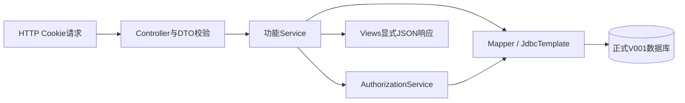

# RBAC0 面向功能后端详细设计

2026-10-18集成版。在成员4/5原后端基础上补齐一期需求，与成员1正式数据库、成员6 API设计及完整界面原型统一。旧设计保留于[成员4/5设计来源](member4-procedural-rbac0-design.md)，输入提交见[合并记账](../stage1/merge-sources.md)。

## 结构与范式

JDK 21、Spring Boot 3.3.5、Spring JDBC。Controller接收HTTP和校验DTO，Service按功能组织认证/授权/校验/事务流水线，Mapper只负责参数化SQL，Views显式构建不含密码的响应。使用少量PO/DTO不改变面向功能实现的核心：授权逻辑集中为可复用步骤，按场景顺序组合；领域对象继承等留待第二阶段独立后端。

| 模块 | 职责 |
| --- | --- |
| `AuthService` | 工号/手机号登录、通用错误、改密、退出 |
| `AuthorizationService` | 会话有效性、初始改密限制、角色/权限并集、管理码映射、范围与目标检查 |
| `MeService` | 本人安全字段、有效权限及来源角色 |
| `UserService` | 范围内查询/增改删、停用/重置、账号保护、用户角色原子替换 |
| `RoleService` | 角色管理、保护/删除确认、成员查询、角色授权原子替换 |
| `DepartmentService` | 只读树、负责人关联、员工数与全部下级成员 |
| `CatalogService` | 目录筛选/分页/全局统计、兼容权限与资源查询 |
| `PortalService` | 按read权限生成菜单、功能点六动作状态 |
| `LedgerService` | 按hr:f046范围查询与仅电话/邮箱编辑 |
| `DataInitializer` | 明确开启时装载合成目录和演示账号；真实Excel走离线导入 |

## 会话与密码

服务端`HttpSession`保存用户ID和当前凭证版本关联，Cookie为`JSESSIONID`。成功登录轮换会话ID，Cookie为HttpOnly、SameSite=Lax，HTTPS启用Secure。每次请求从数据库重新读取账号和授权；账号不存在/停用、凭证已变更等旧会话返回401。退出使会话失效。

首次登录/被重置后`mustChangePassword=true`，只允许本人信息、改密和退出。旧密码正确、新密码8–128字符且不同于旧密码后清除标记；当前改密会话更新凭证状态，其他旧会话失效。重置密码来自部署环境配置，创建与重置接口不接受前端指定初始密码。

新密码与导入统一使用`{pbkdf2@SpringSecurity_v5_8}`前缀的PBKDF2，通过兼容编码器校验已有带前缀哈希。PBKDF2处理完整的8–128字符密码，避免旧BCrypt算法的72字节截断。响应只通过安全字段视图构造，不直接序列化数据库密码字段。

## 鉴权与范围

每个业务操作按认证→权限码→范围→目标检查。权限只来自已分配且启用的角色，集中由`AuthorizationService`计算；没有明确授予一律拒绝。权限在服务端取得，客户端传来的角色/权限不参与鉴权。

同一权限码多角色取`ALL>DEPT>SELF`最大范围；不同码独立。DEPT为本人部门及全部下级；SELF为目标用户ID等于本人。`rbac:*`由系统18源清单权限派生，范围不变，[映射表](../standards/api-contract.md)是契约的一部分。角色授权只接受清单码，不直接接受派生码。

用户与台账查询先裁剪范围再筛选/分页。修改目标和迁入部门都检查；范围外与不存在统一403 OUT_OF_SCOPE，不返回对象字段。员工台账只允许phone/email，编辑权限与查看权限分别计算，不能因查看ALL就允许编辑ALL。

部门成员接口同时过滤人员范围，SELF只返回本人；用户新增为其他账号，SELF创建范围直接拒绝，不能把“本人部门”误当成“本人”。两种管理边界均应由临时SELF角色回归验证。

超级管理员仅预置admin；部门管理员对其部门子树有用户管理权，仅能增删业务角色，不可增删管理类角色或修改角色授权。角色成员查询还按调用者用户查看范围裁剪，缺少用户查看权时返回空集合。

## 事务与版本

用户角色集合使用`sys_user.role_version`；角色直接授权集合使用`sys_role.permission_version`。GET读取版本，PUT提交完整目标集合和version，先做权限/范围/保护/合法性校验，再在事务中比较并递增版本、替换关联。任意一步异常全部回滚；旧版本409 VERSION_CONFLICT含currentVersion，不覆盖并发成功结果。

用户角色替换和角色删除按数字ID升序锁定相关角色行；READ_COMMITTED事务在锁后重读角色管理类分类，用户集合的版本CAS拒绝旧请求。角色删除锁后重新核对成员，避免删除确认与并发授角互相穿透。版本冲突的currentVersion通过锁定当前读获取，避免MySQL可重复读快照返回过期细节；删除角色逐一更新受影响用户版本。

授权数据是`[{code,scope}]`，拒绝重复/未知码与非法范围。非read动作必须同时有本功能read，前端自动勾，后端READ_REQUIRED兜底。失败注入验证属于后端测试，生产API不暴露“模拟失败”开关。

禁止停用/删除自己、改自己角色；用户名为admin或持有ADMIN角色的账号同样受到停用/删除/角色变更保护，不以剩余管理员数量为条件。六个内置角色不可删除，ADMIN不可停用/改授权。有成员的自建角色删除需要confirm=true；删除清理关联并更新受影响用户角色版本。UserMapper在事务中显式将部门负责人置空、删除用户角色关联后删除用户；数据库外键另提供关系一致性兜底。

## 数据与运行

以[正式V001迁移](../../database/migrations/V001__create_core_tables.sql)和[数据字典](../database/data-dictionary.md)为权威。H2仅作为独立测试环境；服务器使用MySQL8.4和持久卷。目录/部门只读，三份原始Excel由离线脚本生成SQL，不提供网页上传。

原清单有3549条五角色授权；平台部门管理员另加六条，完整导入时总数3555。合成演示只验证规则与接口，不能证明111组织和10000员工的原始数据导入已验收。数据初始化不应覆盖已有真实数据。

部署由Nginx提供完整Vue原型、真实后端检查入口及静态API设计，并代理/api到Java。原型内存模拟数据与真实Cookie/MySQL相互独立；本次一期允许分别验收。Java/MySQL端口不发布公网，环境文件不提交Git。

## 测试与限制

接口字段与状态码见[OpenAPI](../../api/openapi.yaml)。后端集成测试覆盖会话、首次改密、保护、范围、原子授权与409；真实HTTP脚本验证Cookie及运行实例；MySQL迁移、全量导入、持久化和性能分别记录，不能用H2通过替代。

实际命令、证据与待执行项见[验证记录](../stage1/verification-record.md)和[自测步骤](../stage1/self-test.md)。角色继承、SSD/DSD/基数、激活角色切换、审计日志、双后端等价属于后续阶段。结构化功能分解、数据流和模块契约见[结构化设计](structured-design.md)。当前服务器公开入口可达性与业务验收结果分别记录，不能由部署文件推断已部署版本或全部测试通过。
