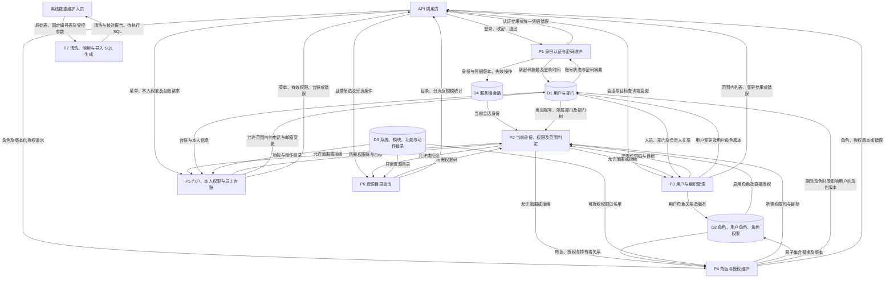
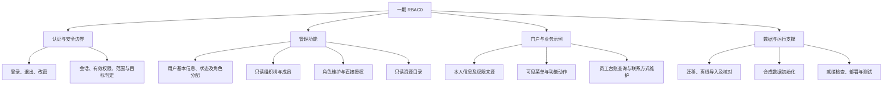
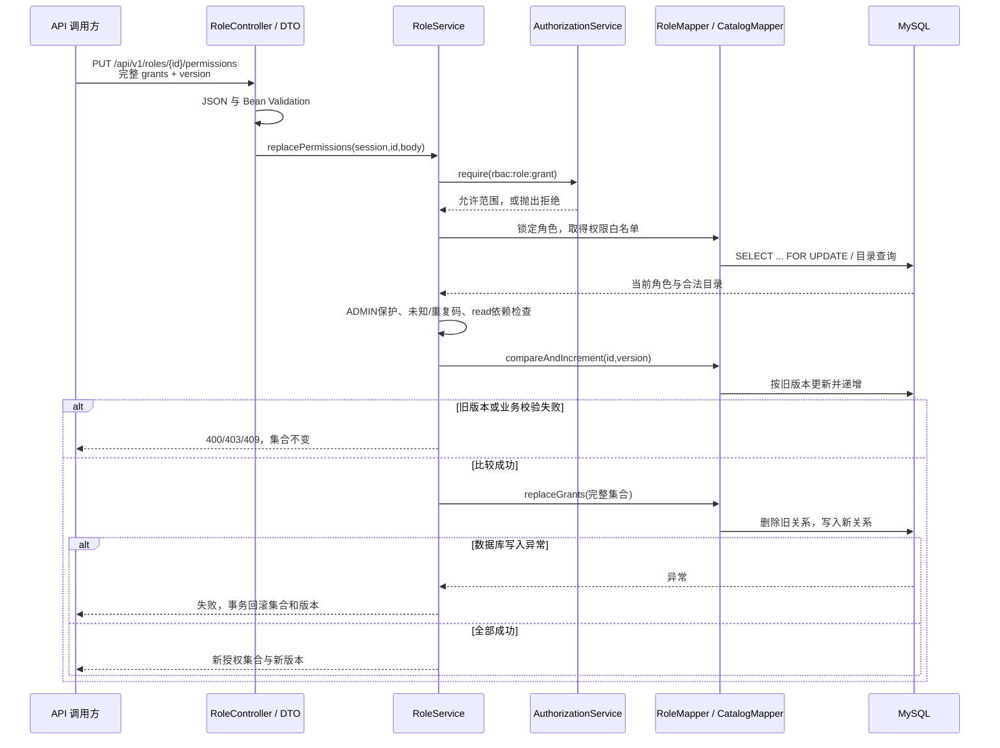

# RBAC0 结构化设计

## 1. 设计范围与依据

一期实现认证、用户与组织查询、角色及授权管理、资源目录、门户权限和员工台账。功能范围对应[需求规格](../requirements/req-spec.md)的 41 条一期需求，HTTP 契约以 [OpenAPI](../../api/openapi.yaml) 为准，表结构以 [V001 迁移](../../database/migrations/V001__create_core_tables.sql)和[数据字典](../database/data-dictionary.md)为准。

真实后端采用 Java 21、Spring Boot、Spring JDBC 和服务端 `HttpSession`。处理流程按功能拆分为 Controller、Service、Mapper；PO 表示持久化数据，DTO 表示请求白名单，VO/Views 显式选择响应字段。按功能组织的服务可以使用 Java 类、依赖注入与记录类型，不能仅凭存在类就将其等同于二期面向对象领域模型。

Vue 界面原型调用独立的[内存模拟 API](../../frontend/src/api/mock.js)，与真实后端的 Cookie 会话和 MySQL 数据分离。原型可用于交互检查，真实接口必须独立调用验证。角色继承、SSD/DSD、主动激活角色、审计日志和面向对象后端属于后续阶段，不参与本期有效权限计算。

## 2. 数据流模型

### 2.1 上下文 DFD

本图边界包括真实 RBAC0 服务和离线数据导入；箭头表示数据流，不表示页面跳转或 Java 调用顺序。

### 2.2 一层 DFD

P7 生成的 SQL 由数据维护人员在受控环境审核后执行，服务端不提供任意原始 Excel 上传接口。D1/D2/D3 是同一数据库内的逻辑分组；D4 是应用进程内的服务端会话，不是新增的业务表。图中 P3 的用户角色写入对应 D2；用户自身的 `role_version` 实际位于 D1 的 `sys_user` 中。

## 3. 功能分解与模块边界

| 层次 | 输入与输出 | 责任 | 约束 |
| --- | --- | --- | --- |
| Controller / DTO | HTTP 参数、JSON、会话 → 服务调用 | 路由、格式校验、HTTP 状态适配 | 不直接执行授权 SQL 或保存角色关系 |
| Service | 已解析的请求与会话 → 明确业务结果 | 认证、权限、范围、保护规则、业务校验、事务 | 不信任客户端提交的身份、权限或管理范围 |
| Mapper / JDBC | 绑定参数 → PO、集合或受影响行数 | 查询、行锁、CAS、关系替换 | 不因被调用就默认已授权；事务由服务层定义 |
| Views / VO | 已授权业务数据 → 显式 JSON 字段 | 分页结果和安全响应 | 不直接序列化含密码摘要的 `UserPO` |

源代码入口：[Controllers](../../backend-procedural/src/main/java/com/municipal/rbac/procedural/controller)、[Services](../../backend-procedural/src/main/java/com/municipal/rbac/procedural/service)、[Mappers](../../backend-procedural/src/main/java/com/municipal/rbac/procedural/mapper)、[请求 DTO](../../backend-procedural/src/main/java/com/municipal/rbac/procedural/dto/Requests.java)、[响应 Views](../../backend-procedural/src/main/java/com/municipal/rbac/procedural/vo/Views.java)。

## 4. 主要模块契约

以下为职责摘要，具体字段、枚举、必填项和 HTTP 响应以 OpenAPI 为准。错误体采用 `error.code/message/requestId/details`；格式错误一般为 400，未认证为 401，无权或越界为 403，资源不存在为 404，版本/保护/唯一性冲突为 409。

| 模块 | 输入 | 输出 / 主要数据 | 关键拒绝与失败处理 |
| --- | --- | --- | --- |
| [AuthService](../../backend-procedural/src/main/java/com/municipal/rbac/procedural/service/AuthService.java) | 工号或手机号、口令；旧/新口令；会话 | 登录身份、改密标记；更新用户摘要和服务端会话 | 不存在、停用、密码错误采用统一凭据错误；旧密码错误及新密码不合规拒绝 |
| [AuthorizationService](../../backend-procedural/src/main/java/com/municipal/rbac/procedural/service/AuthorizationService.java) | 会话、所需权限码、目标用户或部门 | 当前用户、启用角色直接授权并集、指定动作的范围 | 账号/凭据失效 401；未改初始密码、无权限、范围外 403；未知范围不放行 |
| [UserService](../../backend-procedural/src/main/java/com/municipal/rbac/procedural/service/UserService.java) | 人员筛选/分页、基本信息、状态、`roleIds + version` | 范围内用户、角色完整集合及版本；用户与关联表 | 工号/非空手机号冲突；原目标及迁入部门均检查；保护本人/admin；重复、越权角色和旧版本拒绝 |
| [DepartmentService](../../backend-procedural/src/main/java/com/municipal/rbac/procedural/service/DepartmentService.java) | 会话、部门 ID、分页 | 可见组织子树、直接/含下级人数、范围内成员 | 部门可见不代表所有成员可见；SELF 成员查询还须逐人过滤；组织结构只读 |
| [RoleService](../../backend-procedural/src/main/java/com/municipal/rbac/procedural/service/RoleService.java) | 角色信息、删除确认、`grants + version` | 角色、持有者、原始授权及版本；角色关联表 | 内置角色保护；未知/重复权限、缺 read、非法范围拒绝；有成员删除需确认；旧版本 409 |
| [CatalogService](../../backend-procedural/src/main/java/com/municipal/rbac/procedural/service/CatalogService.java) | 系统/模块/关键词、分页 | 系统→模块→功能→动作；目录全局统计 | 需目录查看权限；分页参数非法 400；目录存在不等于当前用户被授予权限 |
| [MeService](../../backend-procedural/src/main/java/com/municipal/rbac/procedural/service/MeService.java) | 当前会话 | 本人安全字段、有效权限最大范围和来源角色 | 本人信息允许改密前读取；权限查询要求已改密；不输出密码摘要 |
| [PortalService](../../backend-procedural/src/main/java/com/municipal/rbac/procedural/service/PortalService.java) | 当前会话、功能码 | 仅含可读叶子的菜单、各动作独立权限和范围 | read 不代表 edit；未知/无权功能不能直接访问 |
| [LedgerService](../../backend-procedural/src/main/java/com/municipal/rbac/procedural/service/LedgerService.java) | 台账筛选、目标 ID、电话/邮箱 | 可见员工及联系方式结果 | 查看与编辑范围独立；禁止附加姓名/角色等字段；范围外与不存在采用相同拒绝 |
| [离线导入](../../database/seeds/import_excel.py) | 受控原始资料、固定编号、初始密码参数 | 清洗报告、业务映射、导入 SQL | 组织关系、账号唯一性、角色与范围规则先验证；原始资料和秘密不进入 Git |
| [HealthController](../../backend-procedural/src/main/java/com/municipal/rbac/procedural/controller/HealthController.java) | 无业务参数 | 就绪状态及一次数据库查询结果 | 未接受流量返回 503；数据库查询异常进入统一错误处理；不替代业务接口验收 |

## 5. 关键调用顺序与一致性

### 5.1 登录与逐请求鉴权

`AuthController` 在格式校验和认证成功后轮换会话 ID。会话记录用户 ID 与登录时密码摘要标记；`AuthorizationService.current` 每次查库核对账号和摘要，因而停用、删除、改密或重置后旧会话在下一请求失效。口令由[密码编码配置](../../backend-procedural/src/main/java/com/municipal/rbac/procedural/config/SecurityConfig.java)处理，服务端不会把摘要发送给前端。

业务服务按“当前身份 → 首次改密限制 → 动作权限 → 数据范围 → 目标”组合公共检查。有效权限只取启用的直接角色，同码取 `ALL > DEPT > SELF`；不同权限码独立。`rbac:*` 由系统管理目录码派生，不接受客户端直接授予。

### 5.2 整组角色授权替换

事务由 `@Transactional` 的服务方法控制；行锁和版本号解决不同问题：锁保证相关关系变更的协调，版本保证旧页面不能覆盖已成功的新结果。`UserService.replaceRoles` 与 `RoleService.delete` 共用角色行锁，角色按数字 ID 升序获取；删除关联时更新受影响用户的版本。不能以“最后一次写入覆盖前一次”替代冲突处理。

列表范围过滤必须早于业务筛选、总数和分页。当前部分列表通过 Mapper 取数后在服务层过滤；其正确性可测试，但大数据性能需要独立测量，不能把内存分页描述为数据库分页优化。

## 6. 内聚与耦合控制

认证、用户、角色、组织、目录、门户和台账按稳定业务职责组织，避免每个 Controller 各自复制权限算法。公共授权服务复用会话、范围与管理码映射；Mapper 通过参数绑定 SQL 和明确受影响行数提供数据契约。密码编码器、Mapper 通过构造器注入，便于隔离替身测试。

跨模块耦合有明确来源：用户角色分配依赖角色保护及管理类识别；组织成员依赖用户归属；菜单依赖目录与有效权限；离线导入依赖固定编码与迁移结构。因此修改角色分类、权限编号、数据范围或表约束时，必须同步检查契约、导入、后端、原型和测试。ID 使用稳定字段，不通过角色名、员工姓名或数组位置推断权限。

## 7. 需求、实现与测试追溯

下表按功能组建立导航；41 条需求逐项状态由[一期需求覆盖表](../stage1/requirement-coverage.md)维护。存在测试代码不代表当前版本已经执行通过，执行结果须另记版本、环境和报告。

| 需求组 | 主要模块 | 后端/配套测试定位 |
| --- | --- | --- |
| LOGIN-01～05 | Auth、Authorization、Me | `Stage1ApiTest` 的通用凭据错误、会话轮换、退出、首次改密、停用/重置会话测试 |
| PORTAL-01～06 | Portal、Me、Ledger | 菜单/目录/来源完整性、SELF台账、经理查看ALL/编辑DEPT、字段白名单测试 |
| USER-01～07 | User、UserMapper | 范围筛选、唯一性、新建/编辑/删除、负责人关联、自身/admin保护测试 |
| DEPT-01～02 | Department、DepartmentMapper | 部门树/成员/角色持有者范围及SELF管理边界测试 |
| ROLE-01～04 | Role、RoleMapper | 角色维护、停用、内置保护、有成员删除确认及并发分配/删除测试 |
| CAT-01～03 | Catalog、Authorization | 目录完整性、管理码派生、未知权限拒绝和管理角色分类测试 |
| GRANT-01～05 | User、Role、Authorization | 整组替换、重复集合、read依赖、409、并发单赢家、数据库失败回滚、即时撤权测试 |
| AUTHZ-01～03 | Authorization 与全部业务服务 | 匿名拒绝、跨范围目标、SELF不泄露同事/不得新建他人、ID异常测试 |
| IMPORT-01～06 | 离线导入、迁移与核对SQL | [导入单元测试](../../tests/unit/test_import_excel.py)、数据库约束及受控全量导入核对 |

[Java 测试源码目录](../../backend-procedural/src/test/java/com/municipal/rbac/procedural)中的隔离层测试使用 JUnit/Mockito 验证授权、认证、维护规则、Controller方法和部门子树算法。Controller直接方法调用不覆盖路由/JSON校验；`DepartmentMapperTest`替身提供`findAll`，不验证SQL或外键。[Stage1ApiTest](../../backend-procedural/src/test/java/com/municipal/rbac/procedural/Stage1ApiTest.java)使用 Spring 上下文、MockMvc 和 H2 验证跨层集成、JDBC写入、事务与并发；[真实 HTTP 脚本](../../scripts/smoke_http.py)验证运行实例与 Cookie。不同层次证据不能单独替代 MySQL 持久化、正式全量导入和服务器现场调用。

## 8. 部署与实现边界

[Compose 配置](../../deploy/compose.yaml)组织 Nginx、Java 和 MySQL，命名卷保存数据库，静态原型和真实 API 共用对外入口。配置文件不等于某台服务器实际采用相同拓扑，应以部署版本和现场状态为证据。

当前版本使用 JDBC 持久化、Compose部署和自定义`/api/v1/health`就绪端点，未引入 JPA 实体映射、自定义 AOP 业务切面、Actuator/Micrometer 指标采集或 Swarm/Prometheus 集群配置。事务仍由Spring事务代理管理。引入新的持久化框架、分布式部署或监控能力时，应补充设计、实现及验证记录。
