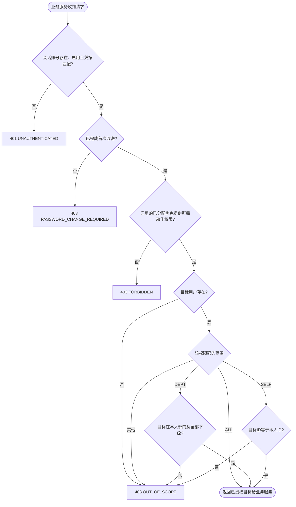
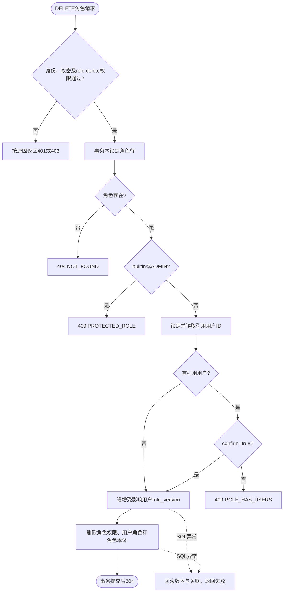

# 关键决策活动

## 1. 用户对象操作的授权与范围

下图抽象服务层对一个用户目标的检查；认证、权限未通过时立即短路。目录/菜单等无用户目标的查询不执行同一套目标判断，本人信息/改密/退出对强制改密状态有显式例外。

同码范围取最大值，不同动作独立。`OUT_OF_SCOPE`不返回目标字段，无法区分目标缺失与范围外。业务写入还需额外校验字段、目标迁入部门、唯一性、保护规则与版本，不能把本图通过等同于写入已经完成。来源：[AuthorizationService](../../backend-procedural/src/main/java/com/municipal/rbac/procedural/service/AuthorizationService.java)。

## 2. 角色删除

`RoleService.delete`和用户授角使用同一角色锁；`lockedUserIds`在锁内确定引用集合，`RoleMapper.delete`先更新用户版本再删关系。READ_COMMITTED与CAS/行锁分别承担一致性职责，不能只靠“删除时有外键级联”替代确认及保护。来源：[RoleService](../../backend-procedural/src/main/java/com/municipal/rbac/procedural/service/RoleService.java)、[RoleMapper](../../backend-procedural/src/main/java/com/municipal/rbac/procedural/mapper/RoleMapper.java)。
