# 设计类图与类职责

**负责人**：成员 5（胡俊朗）　**范围**：一期 RBAC0
**依据**：[需求规格](../requirements/req-spec.md)、[领域模型](domain-model.md)、`backend-procedural/` 实现

> **这张图回答什么**：领域模型里的概念，在软件里由**谁**来负责；类与类之间允许谁依赖谁。
> 它不追求列全所有类——完整清单在 §6，主图只画**关键设计类**。

---

## 1. 设计方法：边界—控制—实体

| 类的类型 | 在本项目里 | 职责 | 设计依据 |
|---|---|---|---|
| **边界类**（boundary） | Controller | 接收 HTTP、绑定并校验 DTO、把结果转成响应 | 一个用例的入口 |
| **控制类**（control） | Service | 编排用例：认证、鉴权、业务规则、事务 | GRASP 的**控制器**：谁负责处理这个用例 |
| **实体类**（entity） | PO / 领域概念 | 承载业务数据与状态 | 领域模型 §2 |
| **仓储类**（repository） | Mapper | 只做参数化 SQL，屏蔽数据库 | GRASP 的**间接**：把持久化隔离出去 |

**职责分配原则**（GRASP）：

- **信息专家**：权限计算放在 `AuthorizationService`，因为它拥有角色、授权、范围所需的全部信息；
- **低耦合 / 高内聚**：Controller 不直接碰 Mapper，鉴权不散落在每个 Service；
- **控制器**：每个用例由一个 Service 统一编排；
- **防止变异**：稳定权限码、DTO/VO 分离、Views 不直接序列化 PO。

---

## 2. 关键设计类图

```mermaid
classDiagram
  direction TB

  class AuthController {
    <<boundary>>
  }
  class UserController {
    <<boundary>>
  }
  class RoleController {
    <<boundary>>
  }
  class DepartmentController {
    <<boundary>>
  }
  class PortalController {
    <<boundary>>
  }

  class AuthService {
    <<control>>
  }
  class UserService {
    <<control>>
  }
  class RoleService {
    <<control>>
  }
  class DepartmentService {
    <<control>>
  }
  class PortalService {
    <<control>>
  }
  class AuthorizationService {
    <<control>>
  }

  class UserMapper {
    <<repository>>
  }
  class RoleMapper {
    <<repository>>
  }
  class DepartmentMapper {
    <<repository>>
  }

  class User {
    <<entity>>
  }
  class Role {
    <<entity>>
  }
  class Permission {
    <<entity>>
  }
  class Department {
    <<entity>>
  }

  class ApiException {
    <<exception>>
  }
  class GlobalExceptionHandler {
    <<boundary>>
  }

  AuthController --> AuthService
  UserController --> UserService
  RoleController --> RoleService
  DepartmentController --> DepartmentService
  PortalController --> PortalService

  AuthController ..> AuthorizationService
  UserController ..> AuthorizationService
  RoleController ..> AuthorizationService
  DepartmentController ..> AuthorizationService
  PortalController ..> AuthorizationService

  AuthService --> UserMapper
  UserService --> UserMapper
  UserService --> RoleMapper
  RoleService --> RoleMapper
  DepartmentService --> DepartmentMapper
  PortalService --> UserMapper

  AuthorizationService --> UserMapper
  AuthorizationService --> RoleMapper
  AuthorizationService --> DepartmentMapper

  UserService ..> User
  RoleService ..> Role
  AuthorizationService ..> Permission
  DepartmentService ..> Department

  AuthService ..> ApiException
  UserService ..> ApiException
  RoleService ..> ApiException
  GlobalExceptionHandler ..> ApiException

  note for AuthorizationService "认证 → 权限码 → 数据范围 → 目标对象，四步短路"
  note for UserMapper "所有查询先裁剪范围，再筛选与分页"
```

---

## 3. 类职责（CRC 表）

> CRC = Class / Responsibility / Collaborator。这是回答「这个类为什么存在」的标准格式。

| 类 | 职责（Responsibility） | 协作者（Collaborator） | 对应需求 |
|---|---|---|---|
| `AuthorizationService` | 会话有效性、首次改密限制、权限并集、范围合并、目标检查 | UserMapper、RoleMapper、DepartmentMapper | AUTHZ-01~03、GRANT-04 |
| `AuthService` | 登录、退出、修改密码 | UserMapper、AuthorizationService | LOGIN-01~05 |
| `UserService` | 范围内用户增删改查、启停、重置、账号保护、角色整组替换 | UserMapper、RoleMapper、AuthorizationService | USER-01~07、GRANT-01 |
| `RoleService` | 角色增删改查、启停、保护规则、授权整组替换、成员查询 | RoleMapper、UserMapper、AuthorizationService | ROLE-01~04、GRANT-02 |
| `DepartmentService` | 部门树、负责人、员工数、下级成员 | DepartmentMapper、AuthorizationService | DEPT-01/02 |
| `PortalService` | 按查看权限生成菜单、功能点六动作状态 | UserMapper、RoleMapper、AuthorizationService | PORTAL-01~06 |
| `UserMapper` | 用户与用户角色关联的参数化 SQL | 数据库 | USER、GRANT |
| `RoleMapper` | 角色、角色授权、行锁与版本号的 SQL | 数据库 | ROLE、GRANT |
| `DepartmentMapper` | 部门树与成员查询的 SQL | 数据库 | DEPT |

---

## 4. 分层职责

### 边界层（Controller，8 个）

**只做三件事**：接收 HTTP、绑定并校验 DTO、调用 Service。
**不做**：业务判断、权限计算、SQL。

| 类 | 主要端点 |
|---|---|
| `AuthController` | `POST /auth/login`、`/auth/logout`、`PATCH /me/password` |
| `MeController` | `GET /me`、`GET /me/permissions` |
| `UserController` | `/users/**` |
| `RoleController` | `/roles/**` |
| `DepartmentController` | `/departments/**` |
| `CatalogController` | `/catalog/**` |
| `PortalController` | `/portal/**` |
| `HealthController` | `/api/v1/health` |

### 控制层（Service，10 个）

**业务逻辑与事务边界的唯一位置。**

| 类 | 职责 |
|---|---|
| `AuthorizationService` | 会话、权限并集、范围与目标检查 |
| `AuthService` | 登录、退出、改密 |
| `UserService` | 用户管理与角色替换 |
| `RoleService` | 角色管理与授权替换 |
| `DepartmentService` | 部门树与成员 |
| `CatalogService` | 目录查询与统计 |
| `PortalService` | 门户菜单与功能点动作 |
| `LedgerService` | 员工台账查看与编辑 |
| `MeService` | 本人信息与有效权限 |
| `EffectivePermissions` | 权限并集的值对象 |

### 仓储层（Mapper，4 个）

**只写参数化 SQL，不含业务判断。**

| 类 | 负责的表 |
|---|---|
| `UserMapper` | `sys_user`、`sys_user_role` |
| `RoleMapper` | `sys_role`、`sys_role_permission` |
| `DepartmentMapper` | `sys_dept` |
| `CatalogMapper` | 目录与权限相关的 5 张表 |

---

## 5. 依赖规则（架构约束）

| 规则 | 说明 |
|---|---|
| Controller **不得**直接依赖 Mapper | 全部经过 Service |
| Service **不得**返回 PO 给 Controller | 必须转 `Views` 或 `Map` |
| Mapper **不得**调用 Service | 单向依赖 |
| 权限判断**只能**在 `AuthorizationService` | 客户端传来的角色/权限不参与鉴权 |
| 事务注解**只在** Service 层 | Controller 无 `@Transactional` |

违反任一条都会破坏可测试性——现有 29 项集成测试依赖这些边界。

---

## 6. 完整类清单（附录）

主图只画关键类。完整清单如下，供查漏：

| 层 | 类 |
|---|---|
| Controller（8） | AuthController、MeController、UserController、RoleController、DepartmentController、CatalogController、PortalController、HealthController |
| Service（10） | AuthService、AuthorizationService、MeService、UserService、RoleService、DepartmentService、CatalogService、PortalService、LedgerService、EffectivePermissions |
| Mapper（4） | UserMapper、RoleMapper、DepartmentMapper、CatalogMapper |
| 数据载体 | UserPO、RolePO、RolePermissionPO、DepartmentPO、Requests、Views、ErrorVO |
| 横切 | ApiException、GlobalExceptionHandler、SecurityConfig、BrowserSecurityConfig |

> `Views` 是一条安全边界：**绝不直接序列化 PO**，否则密码哈希会随响应泄漏。

---

## 7. 与需求、测试的对应

| 需求 | 设计类 | 测试 |
|---|---|---|
| LOGIN-01~05 | AuthController、AuthService、UserMapper | `credentialFailuresAreIndistinguishable`、`firstLoginMustChangeAndChecksOldPassword` |
| USER-01~07 | UserController、UserService、RoleMapper | `createUniqueUserEditResetAndDeleteManagerReference`、`selfAndUniqueAdminProtection` |
| ROLE-01~04 | RoleController、RoleService、RoleMapper | `roleCrudStatusDeleteAndBuiltinGuards` |
| GRANT-01~05 | UserService、RoleService、AuthorizationService | `userRoleVersionConflictAndDuplicateValidation`、`simultaneousCasHasExactlyOneWinner` |
| AUTHZ-01~03 | AuthorizationService、DepartmentMapper | `ledgerSelfScopeAndUnknownFieldProtection`、`departmentUserFiltersCannotEscapeScope` |
| PORTAL-01~06 | PortalController、PortalService | `portalCatalogAndRoleSourcesAreComplete` |

测试方法名与复核项的完整对照见 [成员5 后端复核记录](../testing/member5-backend-review.md)。
