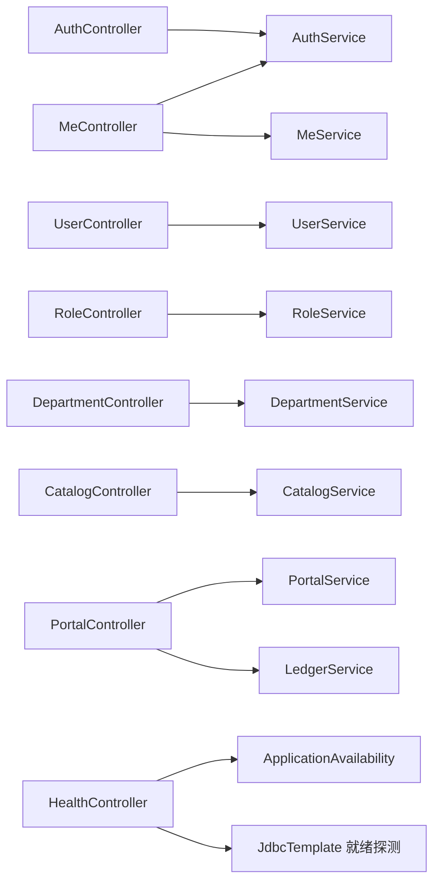
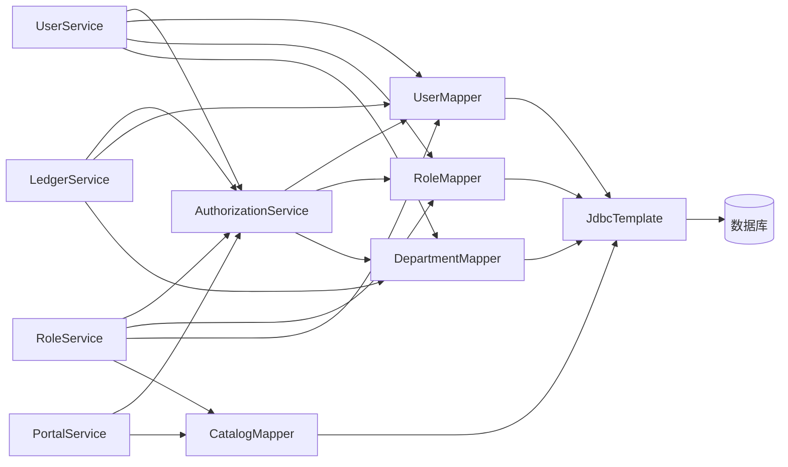

# 模块依赖与职责

一期是按功能组合认证、授权、校验和事务的 JDBC 后端。以下画实际类间协作，不能因采用 Java 类或依赖注入就认定二期领域对象设计已实现。

## HTTP 入口到功能服务

Controller 处理路由、参数/JSON校验及HTTP返回；业务服务调用 `AuthorizationService`。Controller没有直接依赖该授权类。`HealthController` 是独立探测例外，直接查询 `SELECT 1`，不表示业务Controller可以绕过Service写数据。

## 授权及数据依赖

为避免图过密，上图未重复画其他服务与授权的连接；完整依赖摘要如下。

| 服务 | 主要协作者 | 职责 |
| --- | --- | --- |
| AuthService | UserMapper、PasswordEncoder、AuthorizationService、MeService | 认证、退出和密码生命周期 |
| AuthorizationService | UserMapper、RoleMapper、DepartmentMapper | 实时身份、启用角色并集、管理码派生及目标范围 |
| MeService | 三个身份/关系Mapper、AuthorizationService | 本人安全字段和有效权限来源 |
| UserService | User/Role/DepartmentMapper、AuthorizationService、MeService、PasswordEncoder | 范围内人员维护、账号保护、整组授角 |
| RoleService | Role/User/CatalogMapper、AuthorizationService、MeService | 角色保护、持有者过滤、整组授权与删除协调 |
| DepartmentService | Department/UserMapper、AuthorizationService、MeService | 可见部门树和范围内成员 |
| CatalogService | CatalogMapper、AuthorizationService | 只读目录和筛选统计 |
| PortalService | CatalogMapper、AuthorizationService | 可读菜单及功能动作元数据 |
| LedgerService | User/DepartmentMapper、AuthorizationService | 台账范围查询、电话/邮箱白名单编辑 |

`Requests`定义请求白名单，`UserPO/RolePO/DepartmentPO/RolePermissionPO`是数据行形状；`Views`与VO显式组织响应。概念模型中的“User/Permission”等不能当作实际JPA实体类。`GlobalExceptionHandler`统一业务/参数/数据库异常，Filter中的来源拒绝响应由Filter直接构造。

范围过滤、业务筛选及分页顺序由Service控制；部分Mapper先读完整集合，并不自动带用户范围，也不是全部数据库分页。行锁、CAS和关系替换依赖服务层事务，Mapper不能单独保证多语句原子性。

源代码：[Controller](../../backend-procedural/src/main/java/com/municipal/rbac/procedural/controller)、[Service](../../backend-procedural/src/main/java/com/municipal/rbac/procedural/service)、[Mapper](../../backend-procedural/src/main/java/com/municipal/rbac/procedural/mapper)、[DTO](../../backend-procedural/src/main/java/com/municipal/rbac/procedural/dto/Requests.java)、[PO](../../backend-procedural/src/main/java/com/municipal/rbac/procedural/po)、[Views](../../backend-procedural/src/main/java/com/municipal/rbac/procedural/vo/Views.java)。
