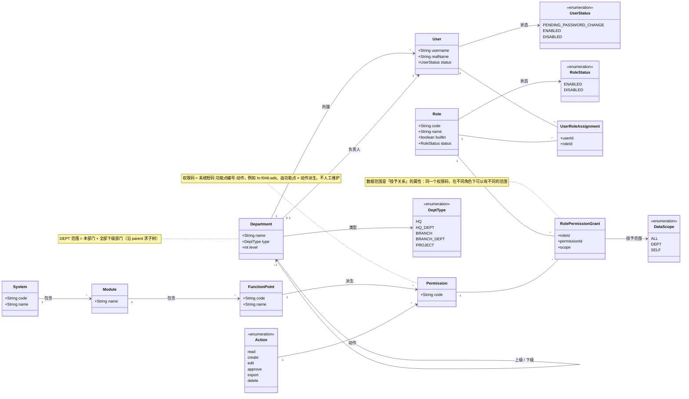

# 领域模型（分析类图）

**负责人**：成员 5（胡俊朗）　**范围**：一期 RBAC0
**依据**：[需求规格](../requirements/req-spec.md)、[数据字典](../database/data-dictionary.md)

> **这张图回答什么**：系统里有哪些**业务概念**，它们之间是什么关系。
> 它不画代码结构——没有 Controller、没有 Mapper、没有密码哈希字段。
> 类职责与分层见 [class-responsibility.md](class-responsibility.md)。

---

## 1. 需求怎么变成概念

| 需求 | 推出的概念 |
|---|---|
| LOGIN-01/02/05 | 用户、账号状态（首次登录必须改密） |
| USER-01 ~ 07 | 用户、部门、账号保护规则 |
| ROLE-01 ~ 04 | 角色、内置角色、角色状态 |
| DEPT-01/02 | 部门、部门层级、负责人 |
| CAT-01/02 | 系统 > 模块 > 功能点 > 动作、权限码 |
| GRANT-01 ~ 05 | 用户—角色分配、角色—权限授予、数据范围 |
| AUTHZ-01 ~ 03 | 权限并集、数据范围判定、默认拒绝 |
| IMPORT-02/03 | 权限由功能点 × 动作派生，不由人工维护 |

**设计方法**：从需求文本里找名词（用户、角色、权限、部门）得到候选概念，再用需求里的动词和约束确定关系与多重性。

---

## 2. 核心领域模型



---

## 3. 为什么这样建模

### 3.1 为什么数据范围挂在「角色—权限」上

范围不是角色的属性，也不是用户的属性，而是**一次授权**的属性。

同一个人，在员工台账上可能「查看 = 本人、编辑 = 全部」。只有把范围放在 `RolePermissionGrant` 上，才能表达这种差异。

**合并规则**：同一个权限码被多个角色授予时，取最宽的范围：

```
ALL  >  DEPT  >  SELF
```

不同权限码之间**不合并**——查看的范围不会放大编辑的范围（对应 GRANT-04）。

### 3.2 权限码为什么是派生的

清单里有 359 个功能点、6 种动作，权限总数是 `359 × 6 = 2154`。

所以 `Permission` 不是人工维护的清单，而是由 `FunctionPoint × Action` 派生出来的。显示名称可以改，**权限码不能改**，否则已有授权会全部失效（CAT-02）。

### 3.3 DEPT 不是「本部门」

`DEPT = 本人所在部门 + 其全部下级部门`。

判断方式：沿 `Department` 的上下级关系求出子树，再看目标用户是否落在子树内。这是部门管理员能管「本部门及下级」的模型依据（AUTHZ-03、DEPT-02）。

### 3.4 账号状态是模型的一部分

用户不是只有「存在 / 不存在」两种状态。首次登录、被重置密码后，账号处于**待改密**状态，只能改密；停用后旧会话在下一次请求失效。

状态迁移见 [state-diagrams.md](state-diagrams.md)。把状态画出来，是为了说明「为什么同一个登录成功的人，权限还可能被限制」。

### 3.5 业务规则（模型约束）

| 规则 | 需求 | 说明 |
|---|---|---|
| 唯一超级管理员 | USER-07 | 只预置 `admin`，不能停用、删除或改其角色 |
| 内置角色不可删 | ROLE-03 | 清单来的 5 个角色 + 部门管理员，共 6 个 |
| 超级管理员角色受保护 | ROLE-03 | 不能停用，也不能修改授权 |
| 不能操作自己 | USER-07 | 停用、删除、改自己的角色都拒绝 |
| 角色有用户时删除需确认 | ROLE-03 | 不是直接拒绝，而是要求二次确认 |
| 默认拒绝 | AUTHZ-02 | 没有明确授予的一律拒绝 |

### 3.6 二、三阶段怎么扩展

| 阶段 | 新增概念 | 对现有模型的影响 |
|---|---|---|
| 二（RBAC1） | 角色继承关系 | `Role` 增加自关联（上级/下级）；有效权限要沿继承求闭包 |
| 三（RBAC2） | 静态/动态互斥、基数约束 | 新增 `Constraint` 概念，约束角色集合 |

一期模型**不画**这两部分，避免让人误以为已经实现。

---

## 4. 概念与实现的对应

| 领域概念 | 数据表 | 实现类 |
|---|---|---|
| Department | `sys_dept` | `DepartmentPO` |
| User | `sys_user` | `UserPO` |
| Role | `sys_role` | `RolePO` |
| Permission | `sys_permission` | — |
| System / Module / FunctionPoint / Action | `app_system` / `app_module` / `app_function` / `sys_action` | — |
| UserRoleAssignment | `sys_user_role` | — |
| RolePermissionGrant | `sys_role_permission` | `RolePermissionPO` |

> 表和类只是概念的落地方式。**模型以本文件为准，代码以实现为准**；两者不一致时，先确认是模型漏了约束，还是实现偏离了需求。

---

## 5. 需求追溯

| 需求 | 模型元素 |
|---|---|
| LOGIN-01/02/05 | User、UserStatus、UserRoleAssignment |
| USER-01 ~ 07 | User、Department、账号保护规则（§3.5） |
| ROLE-01 ~ 04 | Role、RoleStatus、内置角色规则 |
| DEPT-01/02 | Department 自关联、DeptType、负责人 |
| CAT-01/02 | System → Module → FunctionPoint → Permission、Action |
| GRANT-01 ~ 05 | UserRoleAssignment、RolePermissionGrant、DataScope |
| AUTHZ-01 ~ 03 | Permission、DataScope、Department 子树、默认拒绝 |
| IMPORT-02/03 | 权限派生规则、初始角色分配 |

状态与行为见 [state-diagrams.md](state-diagrams.md)；动态交互见 [sequence-diagrams.md](sequence-diagrams.md)。
