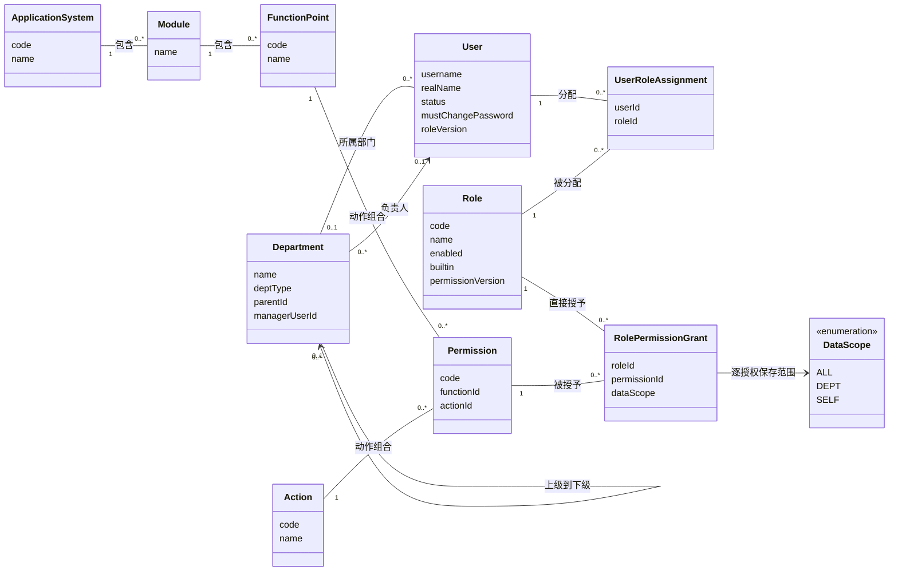

# 业务概念与关系

本图表达一期 RBAC0 的业务概念与持久化关系，不是 JPA 映射或 `backend-oo/` 的实现类图。数据范围属于“角色—权限授予关系”，不属于用户或整个角色。

- 部门根的 `parent_id` 可空，用户 `dept_id` 也可空。一个部门最多一个负责人；数据库没有限制同一用户只能负责一个部门。姓名只展示和核对，关系使用稳定 ID。
- `sys_user.status` 只有启用/停用；`must_change_password` 是独立标记。“已停用且仍待改密”合法，不能把待改密画成第三种互斥账号状态。
- `role_version` 管用户的完整角色集合，`permission_version` 管角色的完整授权集合；都不是会话凭据版本。
- 功能点与六动作在导入/初始化时生成 `sys_permission` 实际记录，权限码稳定为 `系统码:fNNN:动作`；不由客户端任意创建。
- 同码授权取 `ALL > DEPT > SELF`，不同动作各自保留范围；`rbac:*` 管理码由已授予清单码在服务层派生，不另直接写入目录表。

物理字段、唯一键和删除行为以[数据库设计](../database/database-design.adoc)、[数据字典](../database/data-dictionary.md)和[V001迁移](../../database/migrations/V001__create_core_tables.sql)为准。继承边、约束和审计表不属于当前模型。
