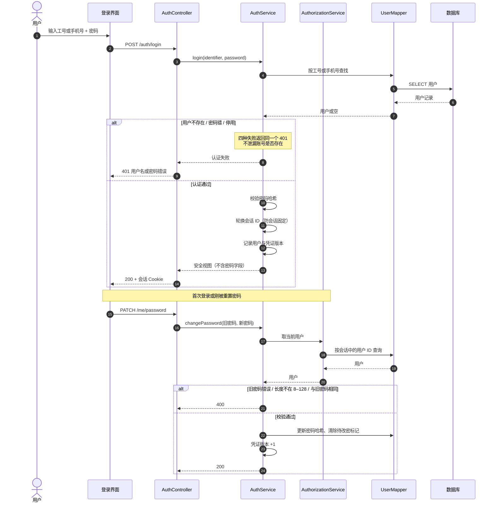
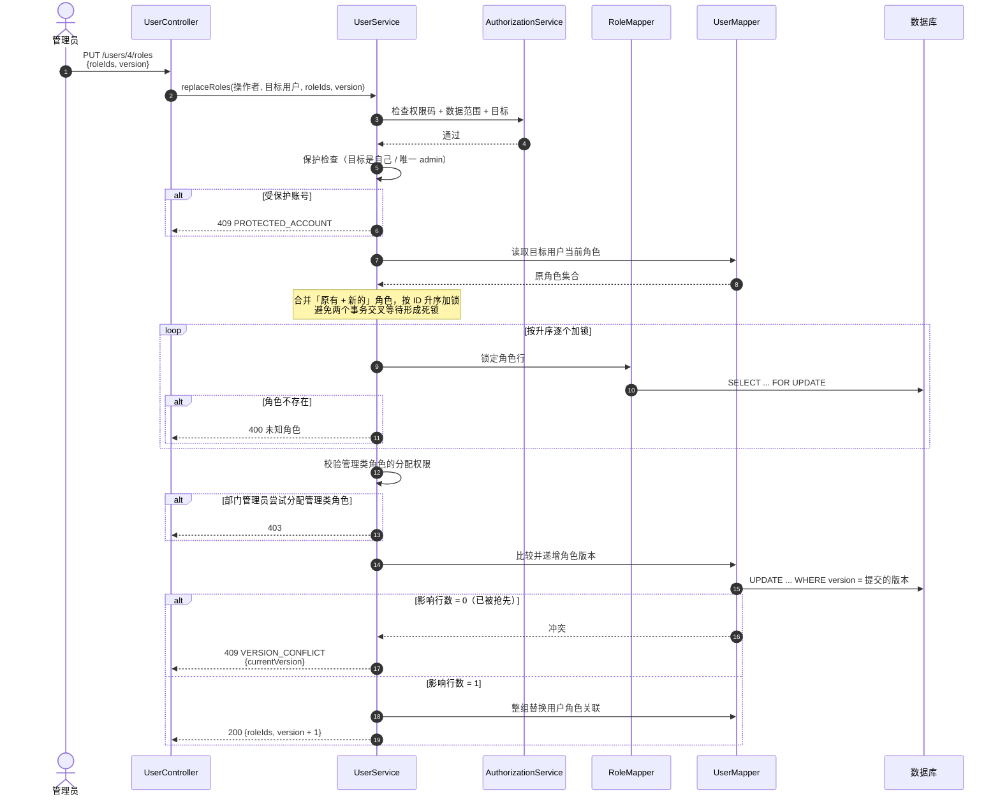
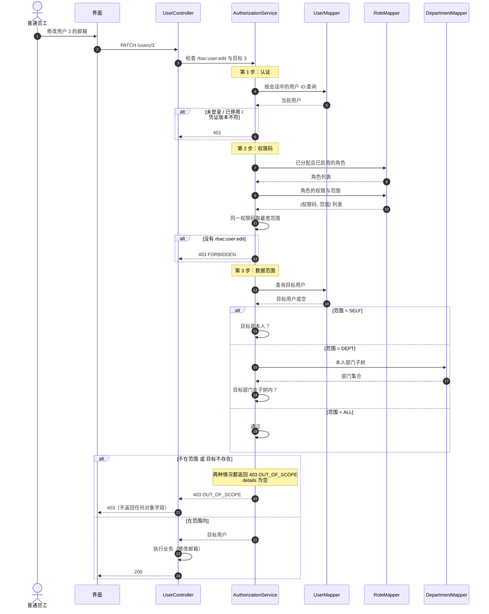
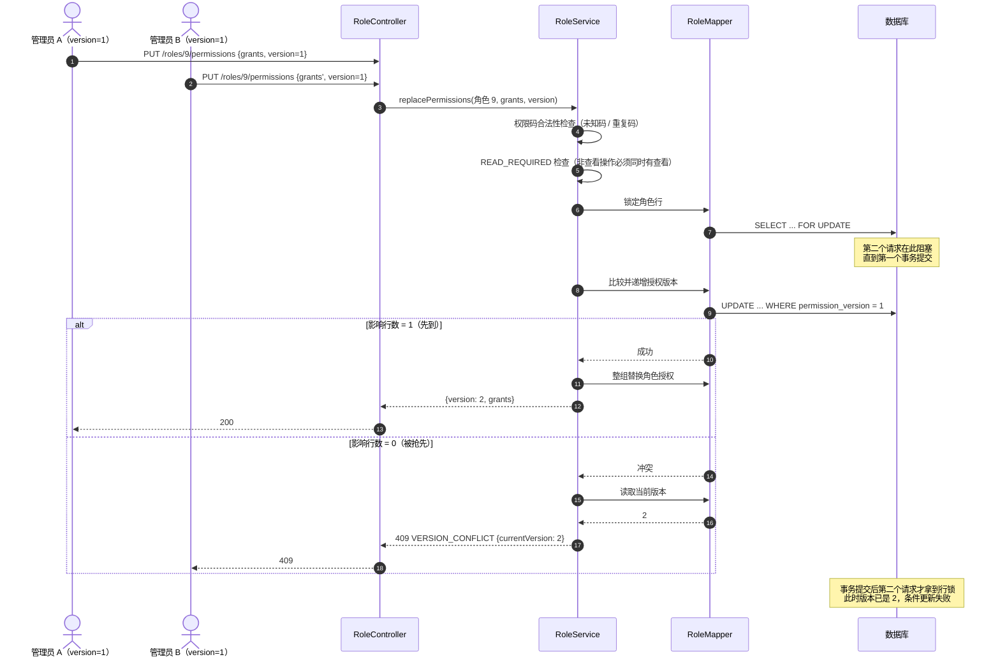
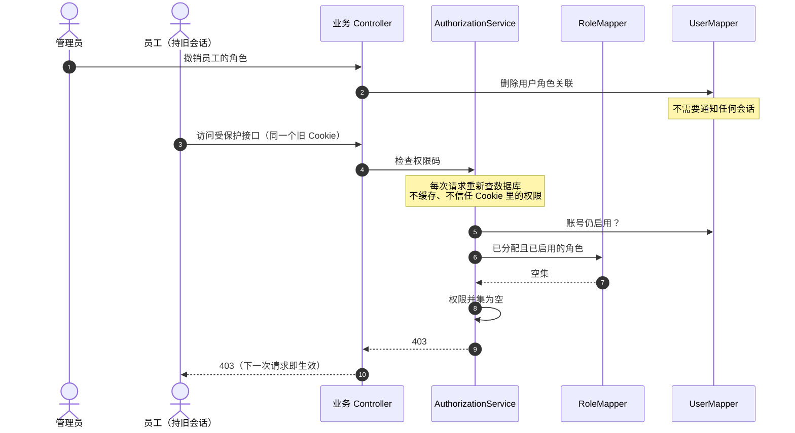
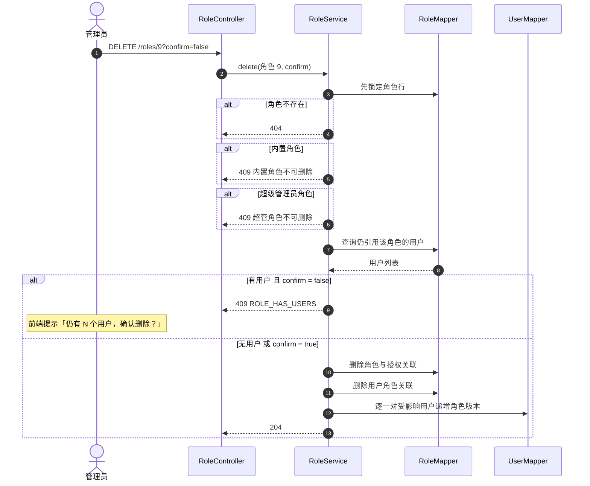

# 关键序列图

**负责人**：成员 5（胡俊朗）　**范围**：一期 RBAC0
**依据**：[需求规格](../requirements/req-spec.md)、[领域模型](domain-model.md)、[设计类图](class-responsibility.md)

> **这张图回答什么**：一个用例在运行时，**哪些对象按什么顺序协作**。
> 选取标准：有并发、有失败分支、有安全含义的流程；不为每个接口画图。

---

## 0. 选图依据

| # | 场景 | 对应用例 / 需求 | 为什么选它 | 位置 |
|---|---|---|---|---|
| 1 | 登录与首次改密 | LOGIN-01/02/04/05 | 会话安全与会话固定防护 | **核心** |
| 2 | 分配用户角色 | GRANT-01/03、USER-07 | 版本冲突、保护规则、加锁顺序 | **核心** |
| 3 | 受保护操作与越权拒绝 | AUTHZ-01/02/03、PORTAL-05 | 鉴权流水线与信息不泄漏 | **核心** |
| 4 | 配置角色权限 | GRANT-02 | 整组替换、`READ_REQUIRED`、事务回滚 | **核心** |
| 5 | 权限变更即时生效 | GRANT-05 | 撤销的时效性 | 附录 |
| 6 | 角色删除与确认 | ROLE-03 | 五道保护与二次确认 | 附录 |

讲解时只讲 **1–4**；5、6 留作追问时的补充。

---

## 1. 登录与首次改密（核心）

**前置**：账号已存在。
**后置**：建立会话；`待首次改密` 状态只能改密。

### 设计要点

| 决策 | 原因 | 需求 |
|---|---|---|
| 四种失败统一 401 | 避免通过错误码枚举出「哪些工号存在」 | LOGIN-01 |
| 登录成功轮换会话 ID | 防会话固定 | LOGIN-02 |
| 改密后凭证版本 +1 | 其他设备上的旧会话下一次请求即失效 | LOGIN-04 |
| 密码用 PBKDF2 | 避免 BCrypt 在 72 字节处截断长密码 | —— |

**测试**：`credentialFailuresAreIndistinguishable`、`firstLoginMustChangeAndChecksOldPassword`、`longPasswordsDoNotAcceptDifferentSuffixBeyondBcryptLimit`。

---

## 2. 分配用户角色（核心）

**前置**：操作者拥有 `rbac:user:assign-role`，目标在数据范围内。
**后置**：用户角色集合被整组替换，版本 +1。

### 设计要点

| 决策 | 原因 | 需求 |
|---|---|---|
| 整组替换 + 版本号 | 避免「先读后写」覆盖别人的修改 | GRANT-01 |
| 先锁行、再读版本 | 锁内读到的版本一定是最新的 | GRANT-01 |
| 按角色 ID 升序加锁 | 消除循环等待，避免死锁 | —— |
| 保护自己与唯一 admin | 防止管理员把自己锁死 | USER-07 |
| 部门管理员不能分配管理类角色 | 防止权限自我放大 | GRANT-03 |

**测试**：`simultaneousCasHasExactlyOneWinner`、`userRoleVersionConflictAndDuplicateValidation`、`selfAndUniqueAdminProtection`、`departmentAdminCannotGrantOrRemoveManagementRoles`。

---

## 3. 受保护操作与越权拒绝（核心）

**前置**：用户已登录。
**后置**：在范围内执行；范围外返回 403，且不返回目标字段。

### 设计要点

| 决策 | 原因 | 需求 |
|---|---|---|
| 先认证 → 再权限码 → 再范围 | 分层短路，越早拒绝成本越低 | AUTHZ-01 |
| 不存在与范围外统一 403 | 防止用状态码差异探测目标是否存在 | AUTHZ-03 |
| `details` 为空 | 不通过错误响应泄漏对象字段 | AUTHZ-03 |
| 查询先裁剪范围再分页 | 否则 `total` 会泄漏范围外的数据量 | USER-01 |

**测试**：`ledgerSelfScopeAndUnknownFieldProtection`、`departmentUserFiltersCannotEscapeScope`。

---

## 4. 配置角色权限与版本冲突（核心）

**前置**：操作者是超级管理员（只有超管能改角色授权）。
**后置**：授权整组替换，版本 +1；失败则完全回滚。

### 设计要点

| 决策 | 原因 | 需求 |
|---|---|---|
| 行锁 + 版本号 CAS | 把并发写串行化，且失败方可感知 | GRANT-02 |
| 整组替换在同一事务 | 任一步失败全部回滚，不留半套授权 | GRANT-02 |
| `READ_REQUIRED` 前置校验 | 避免「能编辑却看不到」的无效授权组合 | GRANT-02 |
| 冲突返回 `currentVersion` | 前端提示刷新，而不是盲目重试 | GRANT-01 |

**测试**：`failedReplacementRollsBackGrantsAndVersion`、`grantValidationVersionAndImmediateChange`、`simultaneousCasHasExactlyOneWinner`。

---

## 5. 权限变更即时生效（附录）

**设计取舍**：每个请求多两次查询，用性能换一致性。撤销不及时比多查两次危险得多（GRANT-05）。

---

## 6. 角色删除与确认（附录）

**三个容易讲错的地方**：

| 点 | 正确说法 |
|---|---|
| 先加锁再判断 | 避免「判断时没人用，删除时正好被分配」的竞态 |
| `confirm` 是第二道闸 | 有用户不是直接拒绝，而是要求调用方确认 |
| 删除要动用户版本号 | 受影响用户的角色集合变了，旧版本必须失效 |

**测试**：`roleCrudStatusDeleteAndBuiltinGuards`、`concurrentAssignmentMakesUnconfirmedRoleDeleteRefuse`。

---

## 7. 四条核心流程的共性

| 共性 | 含义 |
|---|---|
| 鉴权集中在 `AuthorizationService` | 所有 Controller 走同一条流水线，口径一致 |
| 先裁剪范围再分页 | 避免 `total` 泄漏 |
| 失败信息最小化 | 统一 401、统一 403、`details` 不带对象字段 |
| 事务只在 Service 层 | Controller 无事务注解 |
| 版本号由数据库 CAS | 不靠应用层判断，避免竞态 |
| 需要多行加锁时统一升序 | 消除循环等待，避免死锁 |
