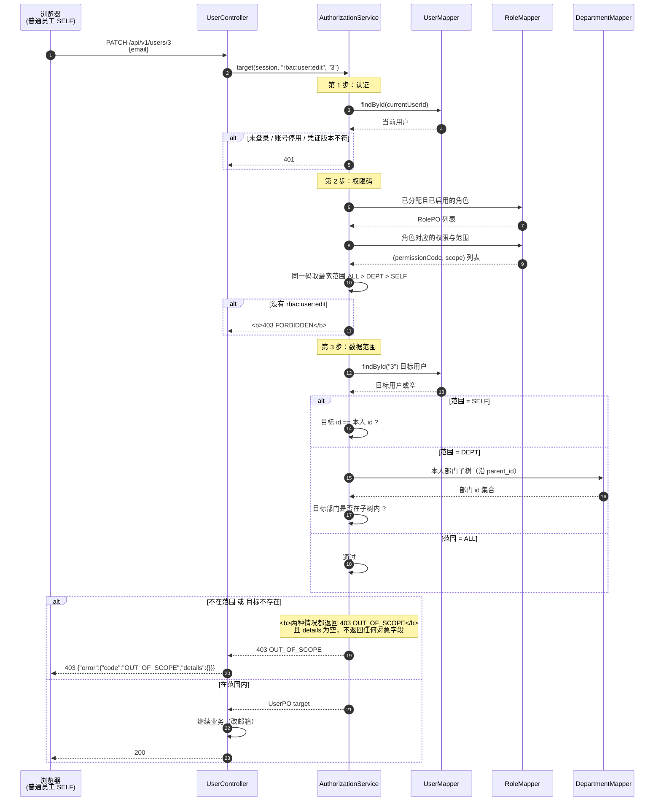
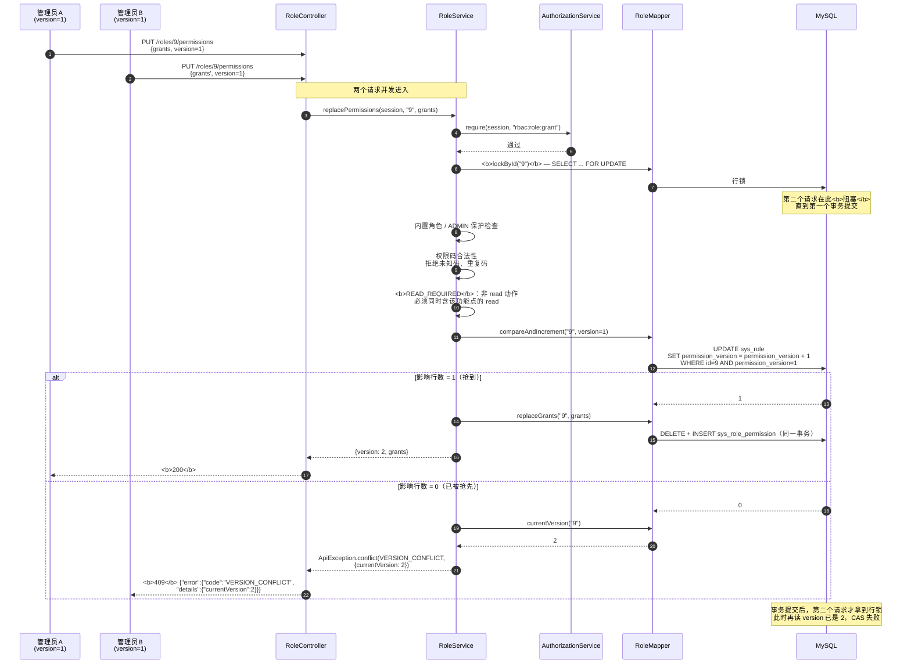
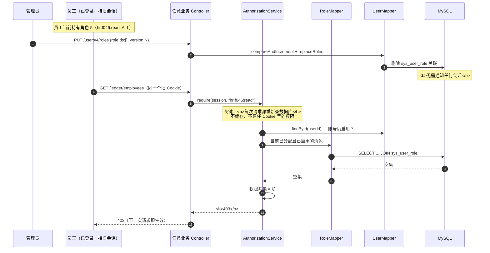

# 关键序列图

**负责人**：成员 5（胡俊朗）　**依据**：`backend-procedural/` 实际实现与 `Stage1ApiTest` 断言
**版本**：2026-10-18 集成版（`2954385`）

本文件选取四条最能体现设计取舍的流程：**认证**、**拒绝**、**并发**、**即时生效**。

---

## 1. 登录与首次改密

```mermaid
sequenceDiagram
  autonumber
  participant B as 浏览器
  participant C as AuthController
  participant S as AuthService
  participant A as AuthorizationService
  participant M as UserMapper
  participant DB as MySQL/H2

  B->>C: POST /api/v1/auth/login<br/>{username 或 phone, password}
  C->>S: login(request, session)
  S->>M: findByUsernameOrPhone(identifier)
  M->>DB: SELECT ... FROM sys_user WHERE username=? OR phone=?
  DB-->>M: UserPO
  M-->>S: Optional<UserPO>

  alt 账号不存在 / 密码错 / 已停用
    Note over S: 四种失败返回<b>同一个 401</b><br/>不泄漏账号是否存在
    S-->>C: throw ApiException(401)
    C-->>B: 401 统一错误包络
  else 认证通过
    S->>S: passwordEncoder.matches(raw, hash)
    S->>S: session.changeSessionId()<br/>防会话固定攻击
    S->>S: session.setAttribute(userId, credentialVersion)
    S-->>C: Views（仅安全字段，不含 password_hash）
    C-->>B: 200 + Set-Cookie: JSESSIONID<br/>HttpOnly; SameSite=Lax
  end

  Note over B,A: ── 首次登录或被重置后，must_change_password=1 ──

  B->>C: PATCH /api/v1/me/password
  C->>S: password(session, request)
  S->>A: requireUserId(session)
  A->>M: findById(currentUserId)
  A-->>S: UserPO
  S->>S: matches(oldPassword, hash)
  alt 旧密码错误 / 长度不在 8–128 / 与旧密码相同
    S-->>C: 400
  else 校验通过
    S->>M: updatePassword(PBKDF2 hash)<br/>must_change_password = 0
    S->>S: 凭证版本 +1 → <b>其他旧会话下一次请求即 401</b>
    S-->>C: 200
  end
```

### 设计要点

| 决策 | 原因 |
|---|---|
| 四种失败统一 401 | 避免通过错误码枚举出"哪些工号存在" |
| 登录成功轮换 sessionId | 防会话固定（session fixation） |
| 密码用 PBKDF2 而非 BCrypt | BCrypt 在 **72 字节**处截断，8–128 字符的长密码会被悄悄截短 |
| 改密后凭证版本 +1 | 让其他设备上的旧会话立即失效，而不是等超时 |

---

## 2. 越权请求被拒绝（403）



### 设计要点

| 决策 | 原因 |
|---|---|
| **不存在 → 403，而非 404** | 若返回 404，攻击者可用状态码差异**探测**哪些用户 ID 存在 |
| `details` 为空 | 不返回目标对象的任何字段，避免通过错误响应泄漏数据 |
| 先认证 → 再权限码 → 再范围 | 分层短路，越早拒绝成本越低 |
| 查询先裁剪范围再分页 | 否则 `total` 会泄漏范围外的数据量 |

> 对应测试：`ledgerSelfScopeAndUnknownFieldProtection`（第 195–201 行）、
> `departmentUserFiltersCannotEscapeScope`（第 235–242 行）。

---

## 3. 角色授权整组替换与 409 版本冲突

这是全系统**并发最难**的一条路径。



### 设计要点

| 决策 | 原因 |
|---|---|
| `SELECT ... FOR UPDATE` 行锁 | 把并发写**串行化**到同一角色行 |
| **先锁行，再读版本** | 锁内读到的版本一定是最新的，不会用到快照里的过期值 |
| `WHERE permission_version = ?` 条件更新 | CAS 的原子性由数据库保证，不靠应用层判断 |
| 失败返回 `currentVersion` | 前端可据此提示"请刷新"，而不是让用户盲目重试 |
| 整组替换在**同一事务** | 任一步异常全部回滚，不留半套授权 |
| `READ_REQUIRED` 前置校验 | 保证不会出现"能编辑却看不到"的无效授权组合 |

> 对应测试：
> - `simultaneousCasHasExactlyOneWinner` — 两线程并发，断言状态码**恰好 `[200, 409]`**
> - `failedReplacementRollsBackGrantsAndVersion` — mock 写入后抛异常，断言版本未变、授权数为 0
> - `userRoleVersionConflictAndDuplicateValidation` — 重复提交 version=1 → 409 且带 currentVersion=2

### 用户角色替换的额外约束

`UserService.replaceRoles` 比角色授权多一层**锁顺序控制**：

```java
// 统一锁顺序：按角色 ID 数值升序，再对目标用户做 CAS
Set<String> lockIds = new TreeSet<>(Comparator.comparingLong(Long::parseLong));
lockIds.addAll(before);
lockIds.addAll(r.roleIds());
for (String roleId : lockIds) roles.lockById(roleId);
```

**为什么必须排序？** 若 A 请求锁 {5,7}、B 请求锁 {7,5}，两边各持一把、互相等待，就形成**死锁**。
统一升序后，任何两个事务的加锁顺序一致，不可能循环等待。

---

## 4. 权限变更即时生效



### 设计要点

| 决策 | 原因 |
|---|---|
| **每次请求重新查权限** | 不在会话里缓存权限，避免"改完要等超时" |
| 不信任客户端传来的角色/权限 | 请求体里的 roleId 只作为"目标值"，不参与鉴权计算 |
| 角色停用同样即时生效 | 查询条件带 `role.status = 1` |
| 账号停用即时生效 | `findById` 后检查 `status`，返回 401 |

> 对应测试：
> - `businessRoleUnionAndImmediateRevocation` — 移除全部角色后**下一次请求**即 403
> - `roleCrudStatusDeleteAndBuiltinGuards` — 停用角色后下一次请求即 403
> - `disableInvalidatesExistingSessionOnNextRequest` — 停用账号后旧会话下一次请求即 401

**代价**：每个请求多两次查询（用户 + 角色权限）。
这是**用性能换一致性**的明确取舍——在权限系统里，**撤销不及时比多查两次危险得多**。

---

## 5. 四条流程的共性

| 共性 | 含义 |
|---|---|
| 鉴权集中在 `AuthorizationService` | 所有 Controller 走同一条流水线，口径一致 |
| 先裁剪范围再分页 | 避免 `total` 泄漏 |
| 失败信息最小化 | 统一 401、统一 403、`details` 不带对象字段 |
| 事务只在 Service 层 | Controller 无 `@Transactional` |
| 版本号由数据库 CAS | 不靠应用层判断，避免竞态 |
