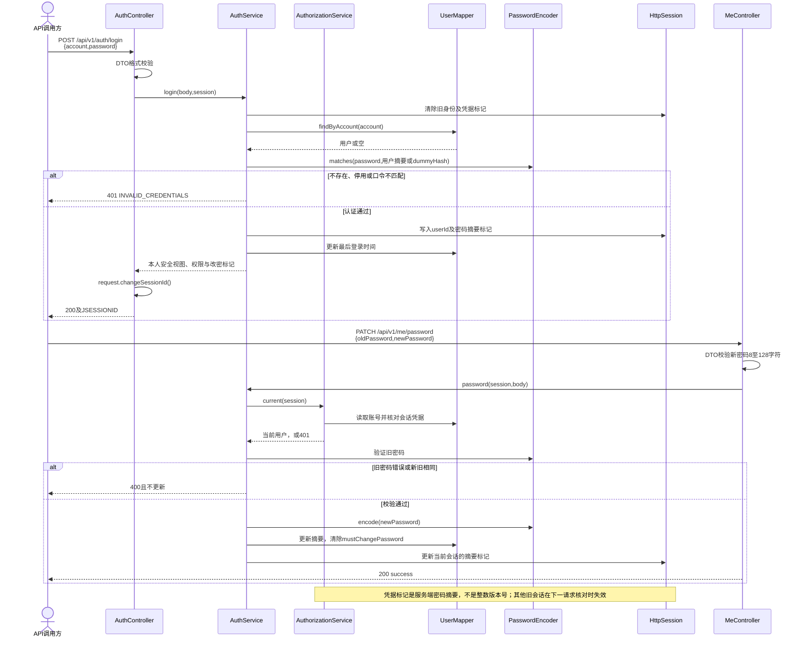
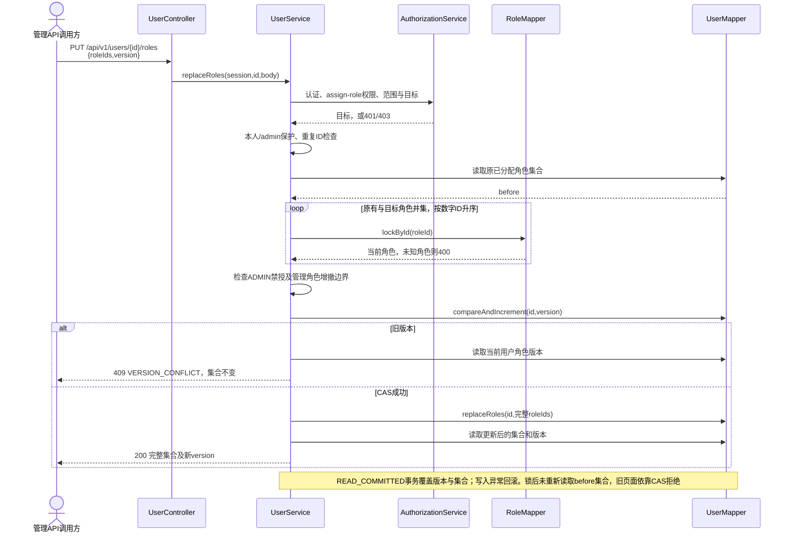
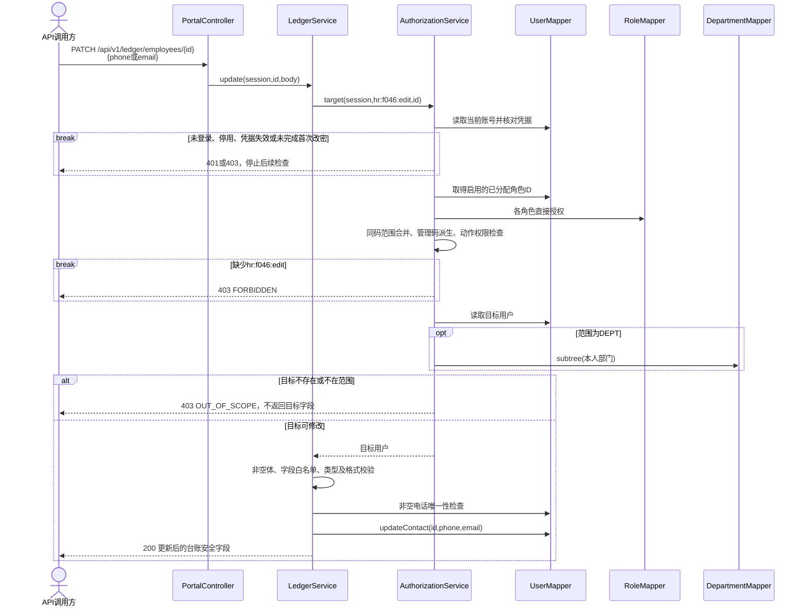
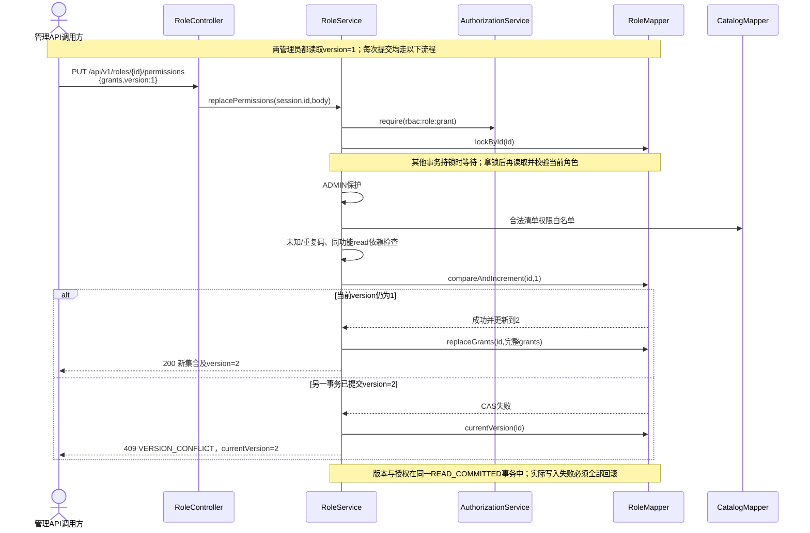
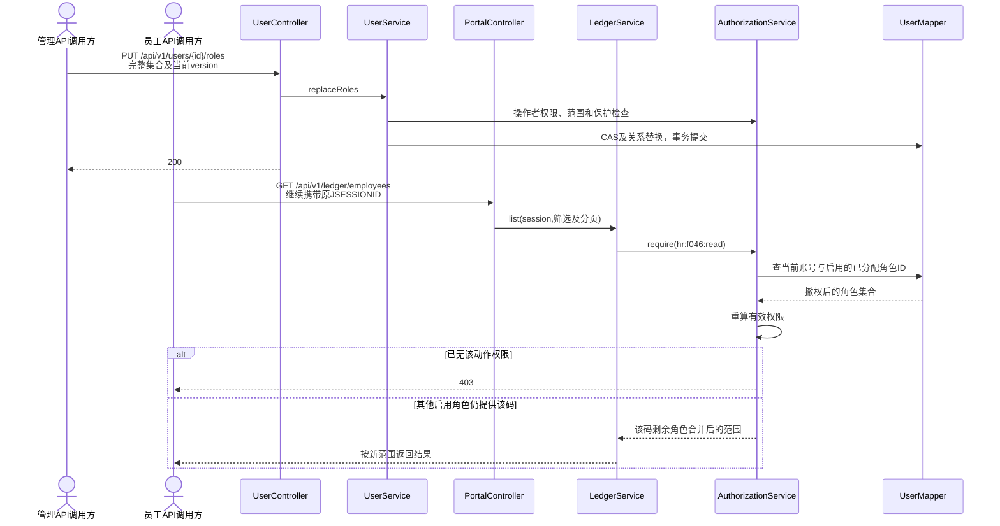
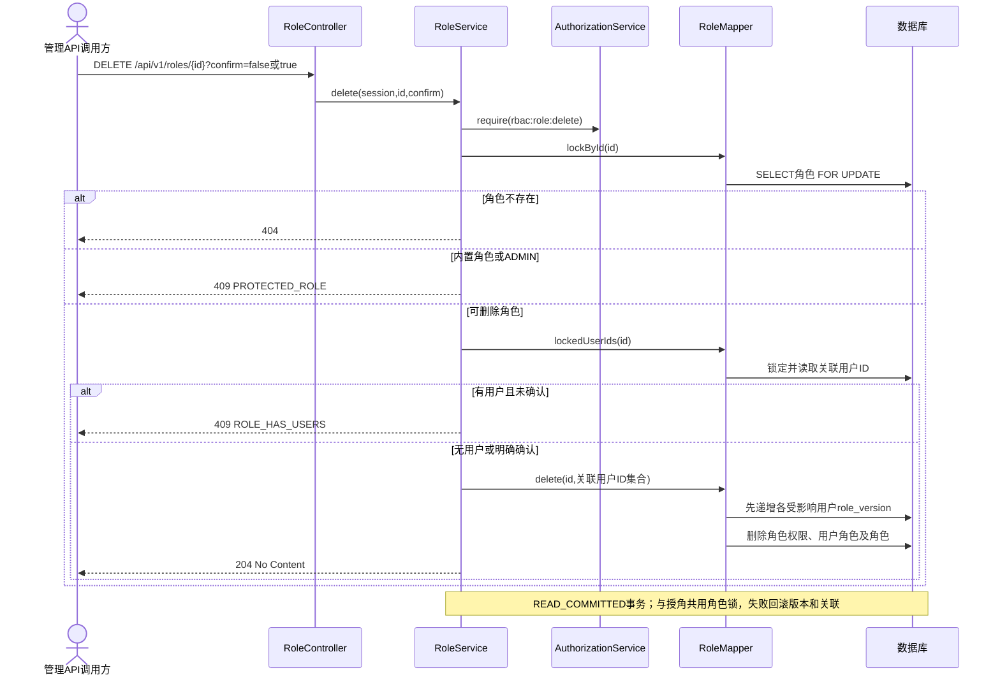

# 关键序列

以下为真实 Java 后端的 API 调用链，路径均写出 `/api/v1`。调用方可以是Swagger或HTTP客户端；当前Vue原型仍调用内存mock，不能把图中的网络链路误认为已完成前后端联调。失败会短路返回，不继续执行后续写入。

## 1. 登录与首次改密

首次改密前，本人信息/改密/退出仍允许；其他业务入口经 `ready/require` 返回403。登录失败锁定属于后续阶段，本图不声称实现锁定计数。参见 [AuthController](../../backend-procedural/src/main/java/com/municipal/rbac/procedural/controller/AuthController.java)、[MeController](../../backend-procedural/src/main/java/com/municipal/rbac/procedural/controller/MeController.java)、[AuthService](../../backend-procedural/src/main/java/com/municipal/rbac/procedural/service/AuthService.java)。

## 2. 整组替换用户角色

角色行锁与删除流程协调；版本检测保护读取后的编辑意图；统一加锁顺序降低交叉锁冲突，不保证数据库所有死锁场景均被消除。参见 [UserService.replaceRoles](../../backend-procedural/src/main/java/com/municipal/rbac/procedural/service/UserService.java)。

## 3. 台账编辑与范围拒绝

图按职责展开成功路径；401/403在对应检查处立即返回，未通过认证/权限时不会继续查询目标。电话/邮箱以外字段返回400；缺字段保留旧值，显式null或空文本清空。若检查用户管理资料修改，实际入口另为 `PUT /api/v1/users/{id}`，权限为 `rbac:user:update`。参见 [LedgerService](../../backend-procedural/src/main/java/com/municipal/rbac/procedural/service/LedgerService.java)。

## 4. 角色授权与旧版本冲突

该图展示同一请求流程的两种结果，不表示两个请求各自都能成功递增。非法参数、保护或权限失败在CAS前拒绝。生产接口没有模拟失败开关，数据库失败回滚由集成测试注入异常验证。参见 [RoleService.replacePermissions](../../backend-procedural/src/main/java/com/municipal/rbac/procedural/service/RoleService.java)。

## 5. 撤权在下一请求生效

只移除一个角色时，其他角色仍可能提供相同权限，不能把“撤角色”一律画成403。会话只保存身份与凭据标记，不缓存角色授权快照；停用账号/密码变更则属于401的身份失效。参见 [AuthorizationService](../../backend-procedural/src/main/java/com/municipal/rbac/procedural/service/AuthorizationService.java)。

## 6. 角色删除与确认

版本更新和删除SQL均由 `RoleMapper.delete` 执行，不经 `UserMapper`。401/403可能在角色锁前发生，不能把所有失败都称为409。参见 [RoleService.delete](../../backend-procedural/src/main/java/com/municipal/rbac/procedural/service/RoleService.java)、[RoleMapper](../../backend-procedural/src/main/java/com/municipal/rbac/procedural/mapper/RoleMapper.java)。
