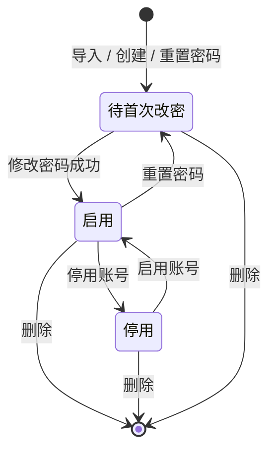
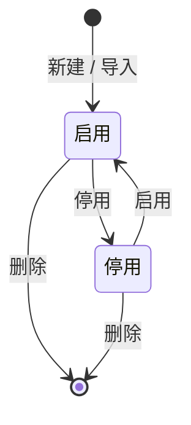

# 状态图

**负责人**：成员 5（胡俊朗）　**范围**：一期 RBAC0
**依据**：需求 LOGIN-05、USER-04/05/07、ROLE-02/03

> **为什么需要状态图**：领域模型只说明「有哪些对象」，说明不了「同一个对象在不同状态下能做什么」。
> 用户和角色都不是只有「存在 / 不存在」两种状态——首次登录、停用、重置密码都会改变**允许的操作集合**。

---

## 1. 用户账号状态

### 状态与允许的操作

| 状态 | 能做什么 | 不能做什么 | 需求 |
|---|---|---|---|
| 待首次改密 | 查看本人信息、修改密码、退出 | 其他所有受保护接口（403 `PASSWORD_CHANGE_REQUIRED`） | LOGIN-05 |
| 启用 | 按权限正常访问 | —— | LOGIN-02 |
| 停用 | —— | 登录；已登录的旧会话在下一次请求返回 401 | USER-04 |

### 关键迁移

| 事件 | 从 | 到 | 说明 |
|---|---|---|---|
| 导入 / 创建 / 重置密码 | — 或 启用 | 待首次改密 | 初始密码不能长期使用 |
| 修改密码成功 | 待首次改密 | 启用 | 同时使其他旧会话失效 |
| 停用 | 启用 | 停用 | 账号状态即时生效，不依赖会话超时 |
| 启用 | 停用 | 启用 | 恢复登录能力 |
| 删除 | 任意 | 终止 | 删除自己或唯一 `admin` 被拒绝（USER-07） |

---

## 2. 角色状态

### 关键规则

| 规则 | 说明 | 需求 |
|---|---|---|
| 停用角色不贡献权限 | 拥有该角色的用户在**下一次请求**即失去这些权限 | ROLE-02、GRANT-05 |
| 内置角色不可删除 | 清单来的 5 个角色 + 部门管理员，共 6 个 | ROLE-03 |
| `ADMIN` 不可停用 | 也不能修改其授权 | ROLE-03 |
| 有用户的自建角色删除需确认 | `confirm=true` 才删除，并清理关联、递增受影响用户的角色版本 | ROLE-03 |

---

## 3. 状态为什么会影响鉴权

这两个状态机解释了鉴权流水线里的两个判断：

1. **账号状态**：每次请求重新读用户，`DISABLED` 直接 401，`PENDING_PASSWORD_CHANGE` 只放行改密相关接口；
2. **角色状态**：只统计 `ENABLED` 的角色，停用角色立刻从权限并集里消失。

因此「权限变更立即生效」不是靠通知会话，而是靠**每次请求重新计算**（见 [sequence-diagrams.md](sequence-diagrams.md) §4）。

---

## 4. 需求追溯

| 需求 | 状态图元素 |
|---|---|
| LOGIN-05 | 待首次改密状态及其出边 |
| USER-04 | 启用 → 停用、停用 → 启用 |
| USER-05 | 重置密码 → 待首次改密 |
| USER-07 | 删除迁移的守卫（自己 / 唯一 admin） |
| ROLE-02 | 角色启用 / 停用 |
| ROLE-03 | 删除迁移的守卫（内置 / ADMIN / 有用户） |
| GRANT-05 | 角色停用后下一次请求生效 |
