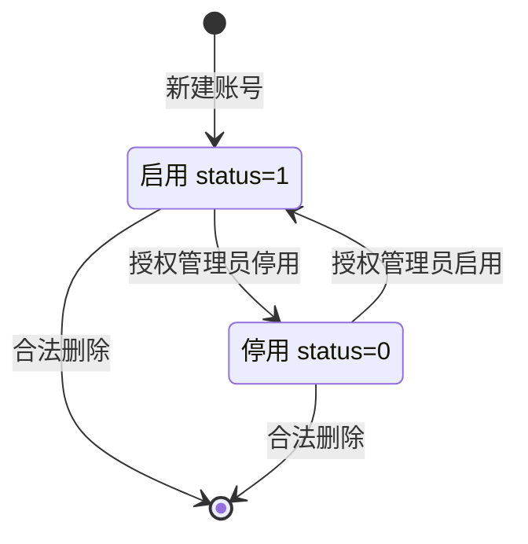
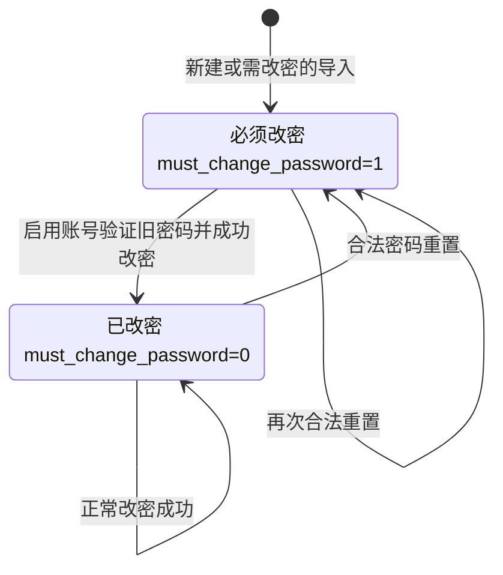
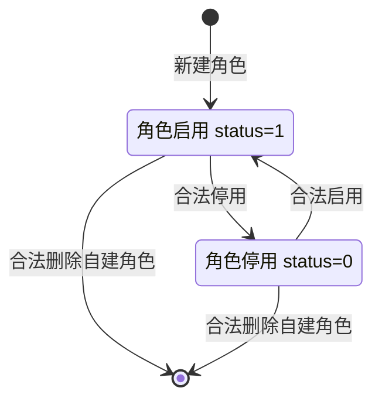

# 状态模型

一期账号的启停状态与强制改密标记相互独立，分别建模。下图是通过权限、范围和保护校验后的合法迁移，不表示任意调用方都可以执行迁移。

## 1. 账号启停

`must_change_password`在停用/启用时保留。停用账号无法登录，旧会话在下一次读取身份时401。本人/admin保护禁止的停用或删除返回409，状态不变；删除清理用户角色并将负责人外键置空。

## 2. 密码维护标记

账号可以同时“停用且必须改密”。密码重置不自动启用账号；恢复启用后仍须改密。强制改密时仅本人信息、改密及退出允许；旧密码错误或参数不合法不改变标记。改密/重置更新密码摘要，使其他旧摘要会话在下一请求失效；当前自行改密会话更新标记继续使用。合成种子中已完成改密的演示账号可直接处于 `Changed`，不能把所有导入都说成同一初态。

## 3. 角色启停

停用保留分配关系，但不贡献有效权限，恢复后重新贡献。六个内置角色不能删除；ADMIN不能停用或改授权。其他内置角色不能删除不等于不能修改其授权。有用户的自建角色需显式确认删除，并在事务内更新受影响用户版本。

来源：[Requests](../../backend-procedural/src/main/java/com/municipal/rbac/procedural/dto/Requests.java)、[AuthService](../../backend-procedural/src/main/java/com/municipal/rbac/procedural/service/AuthService.java)、[UserService](../../backend-procedural/src/main/java/com/municipal/rbac/procedural/service/UserService.java)、[RoleService](../../backend-procedural/src/main/java/com/municipal/rbac/procedural/service/RoleService.java)。
