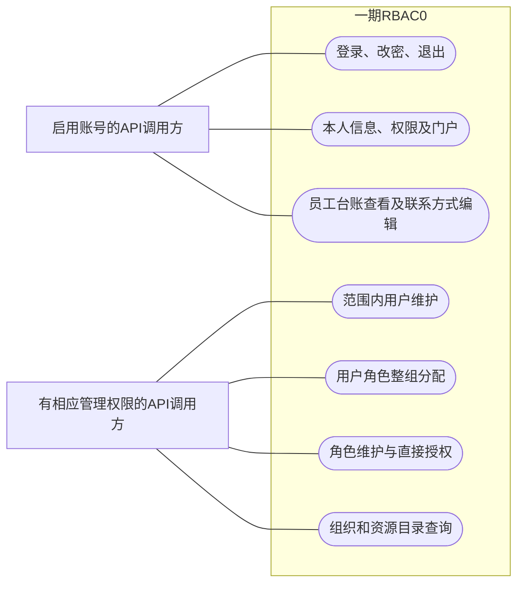

# 一期用例与初始角色

系统按权限码与数据范围判定，不按岗位名称自动授予能力。以下初始角色画像用于理解现有合成账号，不能代替服务端逐请求鉴权；账号同时具有多个角色时须按有效权限并集重新判断。

## 1. 用例范围

这是以流程图表示的用例范围示意，不是Mermaid原生UML用例类型，也不是调用时序。连线表示参与可能性，不表示所有启用账号都能执行所连用例；原型交互与真实API独立。

## 2. 初始授权画像

以仓库合成种子及固定映射为依据，下表只描述相应预置角色，不包含测试临时追加角色后的状态。

| 能力 | ADMIN | DEPT_ADMIN（R06） | 公司领导 | 部门/项目经理 | 普通员工 |
| --- | --- | --- | --- | --- | --- |
| 登录、本人信息、改密、退出 | 启用账号可用 | 启用账号可用 | 启用账号可用 | 启用账号可用 | 启用账号可用 |
| 用户查询/维护 | ALL | DEPT，管理角色边界受限 | 只读ALL | 无管理权限 | 无管理权限 |
| 角色列表 | 可读写，受保护规则约束 | 只读ALL | 只读 | 无管理权限 | 无管理权限 |
| 用户角色分配 | 范围内，不能授ADMIN | 仅DEPT内业务角色 | 不可写 | 不可写 | 不可写 |
| 修改角色权限 | ADMIN自身授权只读 | 无 | 无 | 无 | 无 |
| 组织与成员 | ALL | DEPT | 只读ALL | 无管理权限 | 无管理权限 |
| 资源目录 | 可查看 | R06未授予目录查看 | 可查看 | 无管理权限 | 无管理权限 |
| 员工台账 | read/edit=ALL | R06本身无台账权限 | read=ALL，无edit | read=ALL，edit=DEPT | read/edit=SELF |

R06只有六条管理目录授权，不能因为称为“部门管理员”就推导其拥有台账或权限目录能力。测试会临时给 `DEMO000100` 追加业务角色验证下级部门编辑，这种准备步骤不能省略。公司领导对管理后台只读，不是整个管理后台都不可访问。

源数据：[合成后端种子](../../backend-procedural/src/main/resources/demo-data.json)、[原型种子](../../frontend/src/api/fixtures/demo-data.js)、[后台派生映射](../../backend-procedural/src/main/java/com/municipal/rbac/procedural/service/AuthorizationService.java)。

## 3. 主要用例契约

| 用例 | 正常流程 | 重要拒绝及后置条件 |
| --- | --- | --- |
| 登录/改密 | `POST /auth/login {account,password}`；成功轮换会话ID；`PATCH /me/password`验证旧密码并更新摘要 | 不存在/停用/密码错统一401；首次改密前限制业务入口；口令不返回 |
| 用户维护 | 查询先范围裁剪再筛选/分页；新增基本资料，另行授角；编辑检查目标及迁入部门 | 工号/非空电话唯一；本人/admin保护；范围外与不存在目标统一拒绝 |
| 用户授角 | GET集合及version，PUT完整roleIds | 重复/未知角色、管理角色越界、旧版本拒绝；失败不部分更新 |
| 角色维护/授权 | 角色增改启停；GET授权及version，PUT完整grants | 六内置角色不可删；只有ADMIN授权受不可修改保护，其他内置角色并非一概禁止改授权；未知/重复码、缺read和旧版本拒绝 |
| 门户/本人权限 | 可读叶子生成非空菜单；每个动作分别计算范围并返回来源 | 无角色可登录但无业务权限；直接访问无权功能仍拒绝 |
| 员工台账 | 按`hr:f046:read`查看，按`hr:f046:edit`修改电话/邮箱 | 查看ALL不扩大编辑；未知字段/空体拒绝；越界不返回目标字段 |
| 组织/目录 | 组织按范围返回树及成员，目录为只读系统/模块/功能/动作 | SELF成员只返回本人；目录存在不等于已获得其中业务授权 |

本表路径省略 `/api/v1`；完整字段及状态见[OpenAPI](../../api/openapi.yaml)，41条需求追溯见[覆盖表](../stage1/requirement-coverage.md)。

## 4. 后续阶段

角色继承与面向对象后端为二期；SSD/DSD/基数、会话激活角色、审计及登录失败锁定为后续阶段。当前V001没有角色层级表/字段或审计表，不能把页面静态示例或计划中的迁移当作实现。参见[需求范围](../requirements/req-spec.md)。
